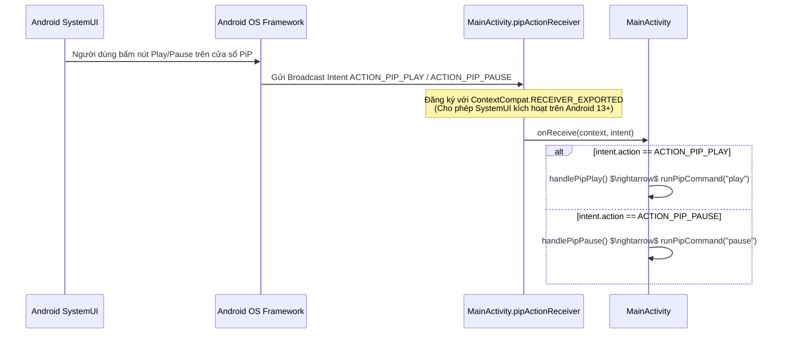

# Giao Diện Giao Tiếp & Lưu Trữ (API & Storage)

Tài liệu này mô tả các giao thức giao tiếp liên tiến trình (IPC), giao diện JavaScript $\leftrightarrow$ Native, Broadcast Intents, Service Actions và cơ chế lưu trữ dữ liệu của ứng dụng **YouTube Lite**.

---

## 1. Giao Tiếp Hai Chiều JavaScript $\leftrightarrow$ Kotlin Native

Hệ thống sử dụng cơ chế lai kết hợp giữa **JavascriptInterface** (chiều từ Web lên Android) và **`evaluateJavascript`** (chiều từ Android xuống Web).

### A. Chiều Web $\rightarrow$ Android: `AndroidBridge`
Được đăng ký trong `MainActivity.kt` thông qua:
```kotlin
webView.addJavascriptInterface(MediaBridge(), "AndroidBridge")
```

| Phương Thức | Tham Số | Mục Đích | Luồng Xử Lý Phía Native |
| :--- | :--- | :--- | :--- |
| `onVideoPlaying(title, channel)` | `title: String`<br>`channel: String` | Web thông báo video bắt đầu phát. | Chuyển sang luồng UI (`runOnUiThread`), gán `isVideoPlaying = true`, lưu tiêu đề, và cập nhật nút PiP thành "Tạm dừng". |
| `onVideoPaused()` | *(Không có)* | Web thông báo video đã dừng. | Chuyển sang luồng UI, gán `isVideoPlaying = false`, và cập nhật nút PiP thành "Phát". |
| `onVideoSize(width, height)` | `width: Int`<br>`height: Int` | Web gửi kích thước thực tế của thẻ video (`videoWidth`, `videoHeight`). | Chuyển sang luồng UI, tính `Rational(width, height)`, so sánh với `videoAspectRatio`. Nếu khác biệt thì cập nhật lại `PictureInPictureParams`. |

### B. Chiều Android $\rightarrow$ Web: `runPipCommand`
Được định nghĩa trong `MainActivity.kt` để gửi lệnh tới đối tượng `window.__bravePip` trong `pip_controller.js`:
```kotlin
private fun runPipCommand(method: String, onResult: ((String?) -> Unit)? = null)
```

| Tên Lệnh (`method`) | Đối Tượng Thực Thi Trên Web | Kết Quả Trả Về |
| :--- | :--- | :--- |
| `"enter"` | `window.__bravePip.enter()` | Kích hoạt CSS cô lập video, gán `data-brave-pip-mode="on"`, trả về `'pip:on'`. |
| `"exit"` | `window.__bravePip.exit()` | Gỡ bỏ thuộc tính cô lập, khôi phục giao diện YouTube bình thường, phát sự kiện resize, trả về `'pip:off'`. |
| `"play"` | `window.__bravePip.play()` | Gọi `HTMLMediaElement.prototype.play()` trực tiếp, trả về `'play'`. |
| `"pause"` | `window.__bravePip.pause()` | Mở khóa thời gian `allowPause(2500)` và gọi `HTMLMediaElement.prototype.pause()`, trả về `'pause'`. |

---

## 2. Hệ Thống Broadcast Intents (PiP Actions)

Cửa sổ nổi PiP của Android tương tác với ứng dụng qua cơ chế Broadcast Intent.



### Chi tiết các Action:
- `com.brave.youtubelite.PIP_PLAY`:
  - **Mã yêu cầu (Request Code):** `1001`
  - **Icon:** `android.R.drawable.ic_media_play`
  - **Nhãn:** `"Phát"`
- `com.brave.youtubelite.PIP_PAUSE`:
  - **Mã yêu cầu (Request Code):** `1002`
  - **Icon:** `android.R.drawable.ic_media_pause`
  - **Nhãn:** `"Tạm dừng"`

---

## 3. Giao Diện Service (`MediaService`)

Dùng để duy trì phát âm thanh khi tắt màn hình.

| Tên Action / Extra | Kiểu Dữ Liệu | Mô Tả |
| :--- | :--- | :--- |
| `MediaService.ACTION_START` | `String` | Lệnh bắt đầu Foreground Service và xin cấp `WakeLock`. |
| `MediaService.ACTION_STOP` | `String` | Lệnh dừng Foreground Service, thu hồi `WakeLock` và ẩn Notification. |
| `MediaService.EXTRA_TITLE` | `String` (Optional) | Tiêu đề video hiển thị trên thanh thông báo (mặc định: `"YouTube Lite"`). |
| `MediaService.EXTRA_CHANNEL` | `String` (Optional) | Tên kênh hiển thị trên thanh thông báo. |

---

## 4. Quản Lý Bộ Nhớ & Lưu Trữ Cục Bộ (Web Storage)

Ứng dụng cấu hình WebView để cân bằng giữa bảo mật và trải nghiệm người dùng:

### A. Bộ Nhớ Web Đã Kích Hoạt
1. **DOM Storage (`domStorageEnabled = true`):**
   - Kích hoạt `localStorage` và `sessionStorage` của HTML5.
   - Giúp YouTube lưu giữ tùy chọn giao diện (chế độ tối/sáng), ngôn ngữ và trạng thái đăng nhập tài khoản Google của người dùng.
2. **IndexedDB / Web SQL (`databaseEnabled = true`):**
   - Cho phép trình phát YouTube lưu cache dữ liệu streaming và metadata video.
3. **HTTP Cache (`WebSettings.LOAD_DEFAULT`):**
   - Sử dụng bộ đệm tiêu chuẩn của trình duyệt theo cache-control header của YouTube, giúp tải nhanh các trang đã xem.

### B. Chính Sách Bảo Mật Lưu Trữ
- `allowFileAccess = false`: Vô hiệu hóa việc truy cập vào hệ thống file của thiết bị (`file://`).
- `allowContentAccess = false`: Chặn việc truy cập tài nguyên Content Provider thông qua WebView.
- `offscreenPreRaster = false`: Vô hiệu hóa việc render trước ngoài màn hình, giúp giải phóng ngay bộ nhớ RAM của các phần tử không nhìn thấy.
