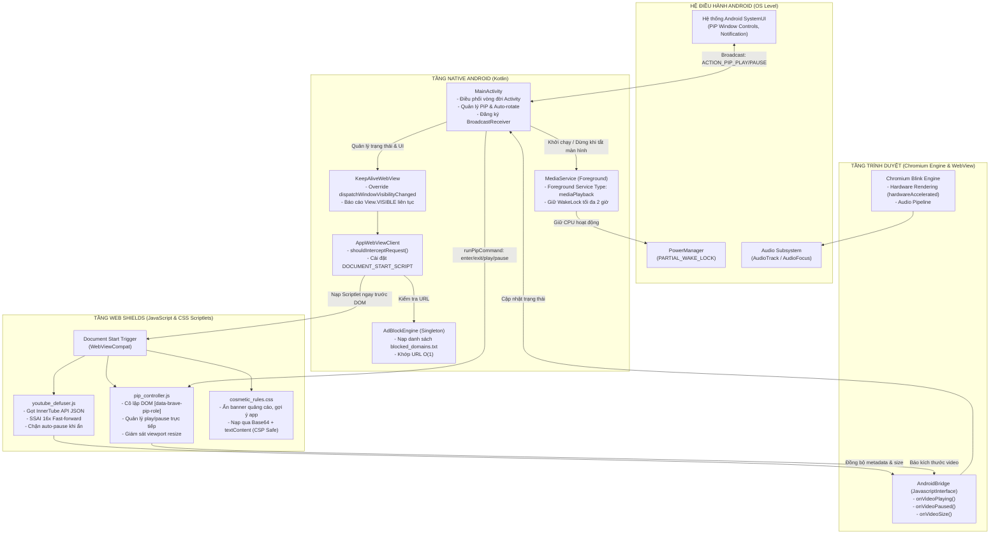
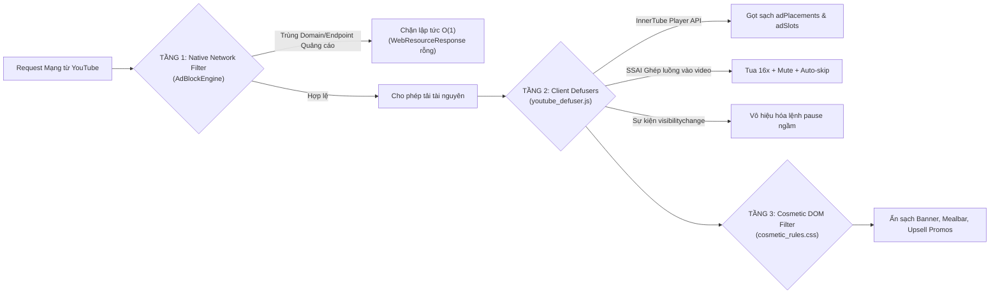
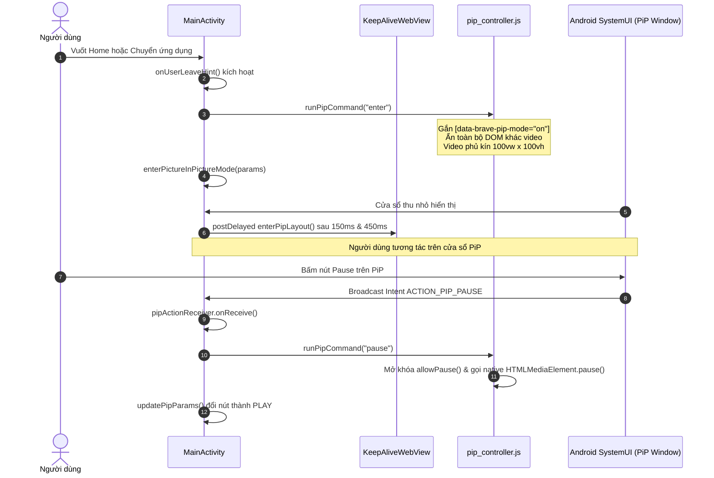

# Kiến Trúc Hệ Thống (System Architecture)

## 1. Sơ Đồ Kiến Trúc Tổng Thể

YouTube Lite được thiết kế theo mô hình lai (Hybrid Native-Web Architecture) lấy cảm hứng từ cấu trúc phân tầng của trình duyệt **Brave Browser**. Hệ thống phân chia ranh giới rõ ràng giữa **Tầng Native Android (Kotlin)** và **Tầng Web Engine (Chromium WebView & Scriptlets)**.



---

## 2. Mô Hình Phòng Thủ 3 Tầng (Brave Shields 3-Tier Model)

Khác với các ứng dụng chặn quảng cáo truyền thống chỉ can thiệp một điểm, YouTube Lite triển khai cơ chế 3 tầng phòng thủ độc lập nhưng tương hỗ chặt chẽ:



### Tầng 1: Native Network Filtering (`AdBlockEngine.kt`)
- **Điểm chặn:** `WebViewClient.shouldInterceptRequest(view, request)`.
- **Cơ chế:**
  - Đối chiếu URL bằng `HashSet<String>` nạp từ `filters/blocked_domains.txt` trong thời gian $O(1)$.
  - Hỗ trợ kiểm tra domain chính xác, kiểm tra subdomain (`host.endsWith(".$blocked")`) và các endpoint telemetry ngầm (`/api/stats/ads`, `/pagead/`, `/youtubei/v1/log_event`).
  - Nếu phát hiện quảng cáo, trả về `WebResourceResponse("text/plain", "UTF-8", ByteArrayInputStream(ByteArray(0)))` ngay lập tức, triệt tiêu lưu lượng mạng trước khi nó chạm đến CPU.

### Tầng 2: Scriptlet & API Defuser (`youtube_defuser.js`)
- **Điểm kích hoạt:** `WebViewCompat.addDocumentStartJavaScript()` (thời điểm `DOCUMENT_START`, thực thi trước khi bất kỳ script nào của trang YouTube chạy).
- **Cơ chế:**
  - **Làm sạch JSON API:** Ghi đè `JSON.parse` và proxy đối tượng `window.ytInitialPlayerResponse` cùng `window.fetch` (`/youtubei/v1/player`). Xóa bỏ hoàn toàn các trường `adPlacements`, `adSlots`, `playerAds`.
  - **Khắc chế SSAI (Server-Side Ad Insertion):** Khi quảng cáo được chèn trực tiếp vào luồng stream video chính (`.ad-showing`), vòng lặp giám sát 150ms sẽ:
    1. Bật `muted = true`.
    2. Đẩy tốc độ phát `playbackRate = 16.0`.
    3. Gán `currentTime = duration` để tua đến khung hình cuối.
    4. Tìm và kích hoạt toàn bộ các nút skip (`.ytp-ad-skip-button`).
    $\rightarrow$ Quảng cáo 30s kết thúc trong ~0.2 giây mà không phát ra tiếng.
  - **Bảo vệ luồng âm thanh:** Chặn sự kiện `visibilitychange`, `webkitvisibilitychange`, `pagehide` và ghi đè getter của `document.hidden = false`, `document.visibilityState = 'visible'`.

### Tầng 3: Cosmetic Filtering (`cosmetic_rules.css`)
- **Cơ chế tiêm:** Nạp file CSS từ assets, mã hóa Base64 và tiêm vào trang bằng script an toàn:
  ```javascript
  style.textContent = (window.TextDecoder ? new TextDecoder('utf-8').decode(bytes) : bin);
  ```
- **Lý do kỹ thuật:** Tránh vi phạm chính sách bảo mật **Trusted Types CSP** trên `m.youtube.com` (YouTube chặn mọi thao tác gán `innerHTML`).
- **Nhiệm vụ:** Ẩn các banner tài trợ, thanh gợi ý "Cài đặt ứng dụng YouTube", popup cảnh báo, và gỡ bỏ `backdrop-filter` để tăng mượt mà khi cuộn trang.

---

## 3. Kiến Trúc Điều Khiển Picture-in-Picture (PiP)

PiP trong YouTube Lite là sự phối hợp giữa **Android Native PiP Framework** và **DOM Isolation Engine** (`pip_controller.js`).



### Điểm nhấn kỹ thuật của PiP:
1. **Cô lập thẻ Video tuyệt đối:** `pip_controller.js` đánh dấu thẻ `<video>` chính bằng `[data-brave-pip-role="video"]` và chuỗi thẻ cha bằng `[data-brave-pip-role="ancestor"]`. Toàn bộ các phần tử khác trong `<body>` được gán `display: none !important`. Điều này ngăn chặn YouTube hiển thị overlay quảng cáo hay tiêu đề video che mất màn hình khi ở kích thước siêu nhỏ.
2. **Kẹp tỉ lệ khung hình (Aspect Ratio Clamping):** Android chỉ chấp nhận tỉ lệ PiP trong khoảng $1:2.39$ đến $2.39:1$. `clampedPipAspectRatio()` trong `MainActivity.kt` đảm bảo không bao giờ ném `IllegalArgumentException`.
3. **Android 13/14 SystemUI RemoteAction:** Nút Play/Pause trên khung PiP được kích hoạt bởi tiến trình hệ điều hành (`com.android.systemui`). Do đó, `pipActionReceiver` được đăng ký với cờ `ContextCompat.RECEIVER_EXPORTED`. Nếu dùng `RECEIVER_NOT_EXPORTED`, nút trên PiP sẽ bị Android 14 chặn hoàn toàn.

---

## 4. Kiến Trúc Giữ Âm Thanh Nền (Background Playback)

Khi điện thoại tắt màn hình, Android thường đưa CPU vào trạng thái ngủ sâu (Deep Sleep) và Chromium engine sẽ tạm ngừng render cũng như các bộ đếm thời gian. YouTube Lite giải quyết vấn đề này qua mô hình 2 lớp:

1. **Lớp Giao Diện (`KeepAliveWebView.kt`):**
   - Override `dispatchWindowVisibilityChanged` và `onWindowVisibilityChanged` để luôn truyền `View.VISIBLE`.
   - Chromium tin rằng cửa sổ vẫn hiển thị đầy đủ trên màn hình, do đó không ngắt audio pipeline.
2. **Lớp Dịch Vụ Hệ Thống (`MediaService.kt`):**
   - Khi `MainActivity.onStop()` được gọi mà `isVideoPlaying == true`, `MediaService` được khởi chạy với cờ `startForegroundService()`.
   - Dịch vụ duy trì `PowerManager.PARTIAL_WAKE_LOCK` (tối đa 2 giờ).
   - Khởi tạo Notification với `FOREGROUND_SERVICE_TYPE_MEDIA_PLAYBACK` theo chuẩn Android 14.
   - Khi người dùng bật lại ứng dụng (`onStart()`), `MediaService` được giải phóng ngay lập tức (`stopMediaService()`) để tiết kiệm năng lượng.
