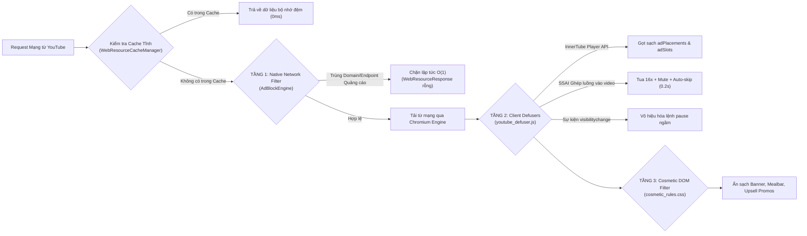

# Kiến Trúc Hệ Thống (System Architecture)

## 1. Sơ Đồ Kiến Trúc Tổng Thể

YouTube Lite được thiết kế theo mô hình lai (Hybrid Native-Web Architecture) kết hợp kiến trúc phòng thủ của trình duyệt **Brave Browser** và mô hình **2 Tầng View Độc Lập (Dual-Layer Native Sliding Sheet)**:

```mermaid
graph TD
    subgraph "HỆ ĐIỀU HÀNH ANDROID (OS Level)"
        SystemUI["Hệ thống Android SystemUI<br>(PiP Window Controls, Notification)"]
        MediaCtl["MediaSession & LockScreen<br>(Bluetooth, Smartwatch, Lockscreen)"]
        PowerMgr["PowerManager<br>(PARTIAL_WAKE_LOCK)"]
        AudioSubs["Audio Subsystem<br>(AudioTrack / AudioFocus)"]
    end

    subgraph "TẦNG NATIVE ANDROID (Kotlin)"
        MainActivity["MainActivity<br>- Điều phối 2 Tầng View<br>- Quản lý MiniPlayer Gestures & Animation<br>- Quản lý PiP & Auto-rotate<br>- Hiển thị BottomSheet Settings"]
        
        subgraph "TẦNG 1: BROWSE VIEW (Duyệt nội dung)"
            SwipeRefresh["SwipeRefreshLayout<br>(Kéo để làm mới)"]
            BrowseWebView["webView (KeepAliveWebView)<br>- Duyệt Trang chủ, Kênh, Tìm kiếm...<br>- Giữ nguyên vị trí cuộn & feed"]
            BrowseClient["AppWebViewClient (isBrowseMode=true)<br>- Tiêm browseWatchInterceptorJs<br>- Chặn SPA pushState & click watch"]
        end

        subgraph "TẦNG 2: PLAYER LAYER (Phát Video & MiniPlayer)"
            PlayerPanel["playerPanel (FrameLayout)<br>- Trượt đè lên / Thu nhỏ 64dp ở đáy"]
            PlayerWebView["playerWebView (KeepAliveWebView)<br>- Chuyên dụng phát video & PiP"]
            MiniPlayerBar["miniPlayerBar (LinearLayout)<br>- Video thu nhỏ 16:9 bên trái<br>- Tiêu đề, Play/Pause, Close bên phải"]
            PlayerClient["AppWebViewClient (isBrowseMode=false)<br>- Tiêm pip_controller & youtube_defuser"]
        end

        subgraph "SERVICES & SINGLETONS"
            MediaSvc["MediaService (Foreground)<br>- Quản lý MediaSessionCompat<br>- NotificationCompat.MediaStyle<br>- Giữ WakeLock tối đa 2 giờ"]
            CacheMgr["WebResourceCacheManager<br>- Bộ nhớ đệm tài nguyên tĩnh (JS/CSS/Font)<br>- Chặn & trả cache tại shouldInterceptRequest"]
            AdEngine["AdBlockEngine (Singleton)<br>- Nạp blocked_domains.txt<br>- Khớp URL O(1)"]
            Settings["AppSettings<br>- Quản lý SharedPreferences<br>- Đồng bộ cấu hình xuống Web Engine"]
        end
    end

    subgraph "TẦNG WEB SHIELDS (JavaScript & CSS Scriptlets)"
        DocStart["Document Start Trigger<br>(WebViewCompat)"]
        WatchInterceptor["browseWatchInterceptorJs<br>- Capture Phase Click Listener<br>- Hook history.pushState/replaceState<br>- Bắn AndroidBridge.openWatchLayer()"]
        Defuser["youtube_defuser.js<br>- Gọt InnerTube API JSON<br>- SSAI 16x Fast-forward<br>- Chặn auto-pause khi ẩn"]
        PiPController["pip_controller.js<br>- Cô lập DOM [data-brave-pip-role]<br>- Quản lý play/pause trực tiếp<br>- Micro-Seek Kick khi vào/ra PiP"]
        CosmeticCSS["cosmetic_rules.css<br>- Ẩn banner quảng cáo, gợi ý app<br>- Nạp qua Base64 + textContent (CSP Safe)"]
        SelectSite["selectSiteSettingsScriptletJs<br>- Nhét mục Cài đặt vào m.youtube.com/select_site"]
    end

    %% Tương tác
    SystemUI <-->|Broadcast: ACTION_PIP_PLAY/PAUSE| MainActivity
    MediaCtl <-->|MediaSessionCompat Callbacks| MediaSvc
    MainActivity --> MediaSvc
    MediaSvc --> PowerMgr

    BrowseWebView --> BrowseClient
    BrowseClient --> AdEngine
    BrowseClient --> CacheMgr
    BrowseClient --> WatchInterceptor
    WatchInterceptor -->|openWatchLayer(url)| MainActivity

    PlayerWebView --> PlayerClient
    PlayerClient --> AdEngine
    PlayerClient --> CacheMgr
    PlayerClient --> Defuser
    PlayerClient --> PiPController
    PlayerClient --> CosmeticCSS

    MainActivity -->|Điều khiển trượt/bung/thu nhỏ| PlayerPanel
    MainActivity -->|runPipCommand: enter/exit/play/pause| PiPController
    PlayerWebView --> AudioSubs
```

---

## 2. Kiến Trúc 2 Tầng View & In-App MiniPlayer (Dual-Layer Native Sliding Sheet)

### Vấn Đề Của Trình Duyệt Web Truyền Thống:
Trên các trình duyệt di động hoặc Web wrapper đơn giản, khi người dùng đang ở Trang chủ và bấm vào 1 video:
- Trang web chuyển hoàn toàn sang URL `/watch?v=...`.
- Khi người dùng muốn tìm video khác, họ phải nhấn Back, khiến trang chủ bị tải lại từ đầu, mất sạch vị trí cuộn và danh sách gợi ý.

### Giải Pháp 2 Tầng View Độc Quyền Của YouTube Lite:
Hệ thống sử dụng **2 cá thể WebView độc lập** được điều phối bởi Native Android:

```
┌────────────────────────────────────────────────────────┐
│  MÀN HÌNH CHÍNH (MainActivity)                         │
│                                                        │
│  ┌──────────────────────────────────────────────────┐  │
│  │ TẦNG TRÊN: playerPanel (Sliding Player Layer)    │  │
│  │                                                  │  │
│  │ [EXPANDED]: Che kín toàn màn hình khi xem video  │  │
│  │                                                  │  │
│  │ [COLLAPSED]: Thu nhỏ thành MiniPlayer Bar (64dp) │  │
│  │  ┌──────────┬──────────────────────┬───┬───┐    │  │
│  │  │ Video    │ Tiêu đề video & kênh │ ▶ │ ✕ │    │  │
│  │  └──────────┴──────────────────────┴───┴───┘    │  │
│  └──────────────────────────────────────────────────┘  │
│                                                        │
│  ┌──────────────────────────────────────────────────┐  │
│  │ TẦNG DƯỚI: SwipeRefreshLayout + webView (Browse) │  │
│  │                                                  │  │
│  │ • Duyệt Trang chủ, Kênh đăng ký, Tìm kiếm...     │  │
│  │ • 100% Giữ nguyên vị trí cuộn & feed             │  │
│  │ • Hoàn toàn không bị che khuất khi MiniPlayer    │  │
│  │   thu nhỏ ở đáy!                                 │  │
│  └──────────────────────────────────────────────────┘  │
└────────────────────────────────────────────────────────┘
```

1. **Tầng Dưới (`webView` - Browse View):**
   - Chỉ đảm nhiệm việc duyệt bảng tin (Trang chủ, Tab Đăng ký, Tìm kiếm, Trang Kênh cá nhân).
   - Được bảo vệ bởi scriptlet `browseWatchInterceptorJs`.
   - Khi người dùng bấm vào một video trên trang chủ: Scriptlet bắt sự kiện `click` ở Capture Phase và hook `history.pushState` của SPA router, chặn không cho `webView` chuyển trang, đồng thời bắn URL video sang Native thông qua `AndroidBridge.openWatchLayer(url)`.

2. **Tầng Trên (`playerPanel` - Player Layer):**
   - Chứa `playerWebView` chuyên trách phát video, xử lý âm thanh, fullscreen và PiP.
   - Khi nhận URL từ tầng dưới, `playerPanel` bung to (`EXPANDED`) và bắt đầu phát video.
   - Khi người dùng vuốt xuống (`playerDragArea`) hoặc bấm nút mũi tên xuống: `collapsePlayer()` trượt xuống đáy và co kích thước của `playerPanel` về đúng **64dp** ở đáy màn hình.
   - Video thu nhỏ được scale mượt mà vào khung 104dp bên trái thanh `miniPlayerBar`. Toàn bộ vùng màn hình phía trên thuộc về `webView`, cho phép người dùng cuộn và tương tác trang chủ 100% tự do.

---

## 3. Mô Hình Phòng Thủ 3 Tầng (Brave Shields 3-Tier Model)



### Tầng 1: Native Network Filtering (`AdBlockEngine.kt`)
- **Điểm can thiệp:** `WebViewClient.shouldInterceptRequest(view, request)`.
- **Cơ chế:**
  - Tra cứu trong `HashSet<String>` nạp từ `filters/blocked_domains.txt` trong thời gian $O(1)$.
  - Hỗ trợ domain chính xác, subdomain (`host.endsWith(".$blocked")`) và các endpoint telemetry ngầm (`/api/stats/ads`, `/pagead/`, `/youtubei/v1/log_event`).
  - Nếu phát hiện quảng cáo, trả về `WebResourceResponse("text/plain", "UTF-8", ByteArrayInputStream(ByteArray(0)))` ngay lập tức.

### Tầng 2: Scriptlet & API Defuser (`youtube_defuser.js`)
- **Điểm kích hoạt:** `WebViewCompat.addDocumentStartJavaScript()` (thời điểm `DOCUMENT_START`).
- **Cơ chế:**
  - **Gọt JSON API:** Ghi đè `JSON.parse` và proxy đối tượng `window.ytInitialPlayerResponse` cùng `window.fetch` (`/youtubei/v1/player`). Xóa bỏ hoàn toàn các trường `adPlacements`, `adSlots`, `playerAds`.
  - **Khắc chế SSAI (Server-Side Ad Insertion):** Khi quảng cáo được chèn trực tiếp vào luồng stream video chính (`.ad-showing`), vòng lặp giám sát 150ms sẽ:
    1. Bật `muted = true`.
    2. Đẩy tốc độ phát `playbackRate = 16.0`.
    3. Gán `currentTime = duration` để tua đến khung hình cuối.
    4. Tìm và kích hoạt toàn bộ các nút skip (`.ytp-ad-skip-button`).
    $\rightarrow$ Quảng cáo kết thúc trong ~0.2 giây mà không phát ra tiếng.
  - **Bảo vệ luồng âm thanh:** Chặn sự kiện `visibilitychange`, `webkitvisibilitychange`, `pagehide` và ghi đè getter của `document.hidden = false`, `document.visibilityState = 'visible'`.

### Tầng 3: Cosmetic Filtering (`cosmetic_rules.css`)
- **Cơ chế tiêm:** Nạp file CSS từ assets, mã hóa Base64 và tiêm vào trang bằng script an toàn tuân thủ Content Security Policy (Trusted Types):
  ```javascript
  style.textContent = (window.TextDecoder ? new TextDecoder('utf-8').decode(bytes) : bin);
  ```

---

## 4. Hệ Thống Bộ Nhớ Đệm Tĩnh (Static Preload Cache Manager)

`WebResourceCacheManager` hoạt động song song với `AdBlockEngine` tại `shouldInterceptRequest`:
- Nhận diện các tài nguyên tĩnh: JavaScript bundles (`desktop_polymer_v2*.js`, `mweb_*.js`), CSS, Web Fonts (`roboto*.woff2`), SVG Icons.
- Lưu trữ cục bộ trong thư mục `cache/web_static/` của ứng dụng với mã băm MD5 làm định danh khóa.
- Khi trang yêu cầu lại, trả về dữ liệu từ bộ nhớ đệm cục bộ với mã trạng thái HTTP 200, loại bỏ hoàn toàn độ trễ mạng và tiết kiệm tối đa băng thông 4G/5G.
