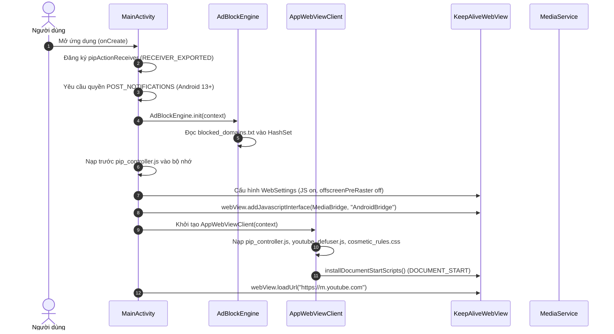
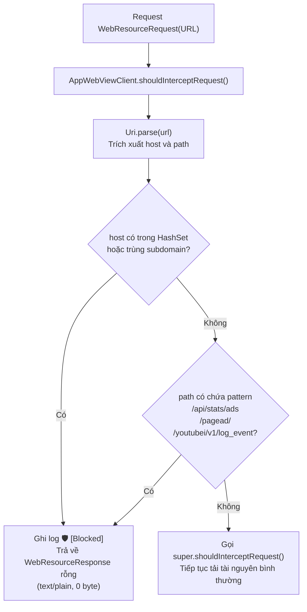
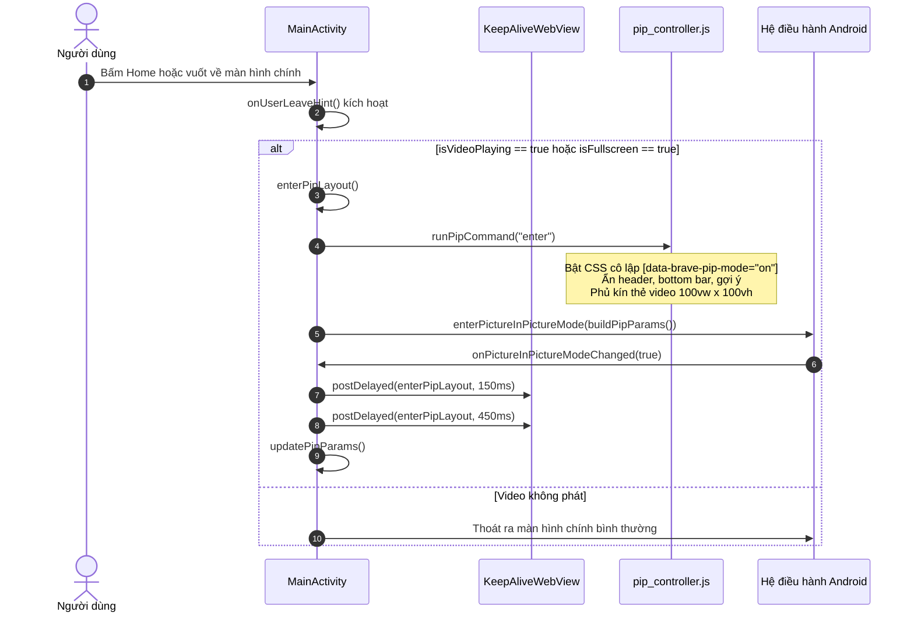
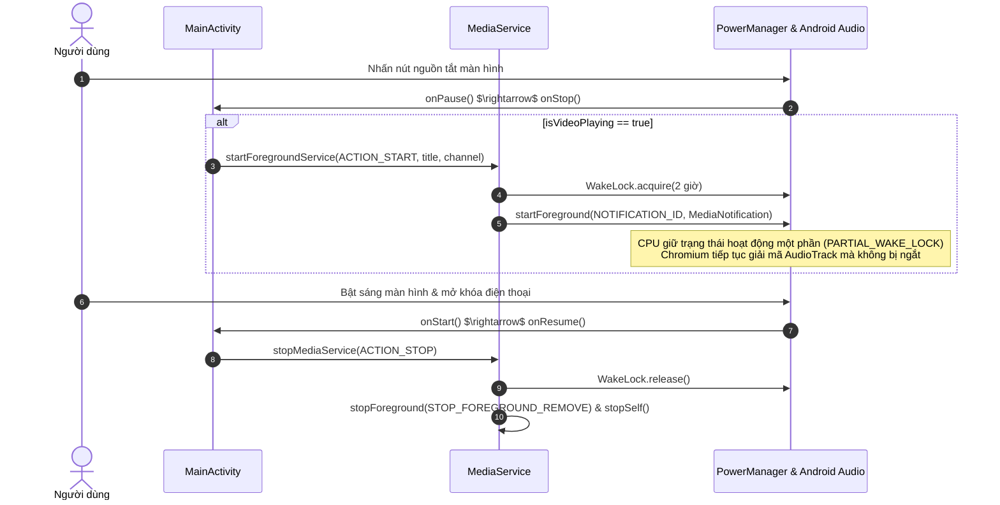

# Luồng Dữ Liệu & Trình Tự Hoạt Động (Data Flow)

Tài liệu này mô tả chi tiết các luồng sự kiện, luồng dữ liệu mạng, vòng đời tương tác giữa người dùng, hệ điều hành Android, mã nguồn Kotlin Native và các Scriptlet Web.

---

## 1. Luồng Khởi Động Ứng Dụng (Application Startup Flow)



---

## 2. Luồng Chặn Mạng Tầng Native (Network Interception Flow)

Mỗi khi trình duyệt nội bộ gửi yêu cầu tải bất kỳ tài nguyên nào (HTML, script, ảnh, video chunk, telemetry), yêu cầu đó đều đi qua bộ lọc `shouldInterceptRequest`:



---

## 3. Luồng Đồng Bộ Trạng Thái JavaScript $\leftrightarrow$ Kotlin Native

Trạng thái của video đang phát được đồng bộ liên tục để phục vụ cho cửa sổ PiP và Foreground Service:

```mermaid
sequenceDiagram
    autonumber
    participant Video as HTML5 Video Element
    participant Defuser as youtube_defuser.js
    participant PiPJS as pip_controller.js
    participant Bridge as AndroidBridge (JavascriptInterface)
    participant Main as MainActivity

    Video->>Defuser: Sự kiện "play" hoặc "playing"
    Defuser->>Defuser: Trích xuất Title & Channel từ DOM
    Defuser->>Bridge: AndroidBridge.onVideoPlaying(title, channel)
    Bridge->>Main: runOnUiThread { isVideoPlaying = true; currentTitle; currentChannel; }
    Main->>Main: updatePipParams() (Nút đổi thành PAUSE)

    Video->>PiPJS: Sự kiện "loadedmetadata" / "resize"
    PiPJS->>Bridge: AndroidBridge.onVideoSize(width, height)
    Bridge->>Main: runOnUiThread { videoAspectRatio = Rational(w, h); }
    Main->>Main: updatePipParams() (Khung PiP khớp tỉ lệ thật)

    Video->>Defuser: Sự kiện "pause"
    Defuser->>Bridge: AndroidBridge.onVideoPaused()
    Bridge->>Main: runOnUiThread { isVideoPlaying = false; }
    Main->>Main: updatePipParams() (Nút đổi thành PLAY)
```

---

## 4. Luồng Chuyển Đổi Sang Picture-in-Picture (PiP Flow)



---

## 5. Luồng Duy Trì Âm Thanh Khi Khóa Màn Hình (Screen Off Lifecycle Flow)


