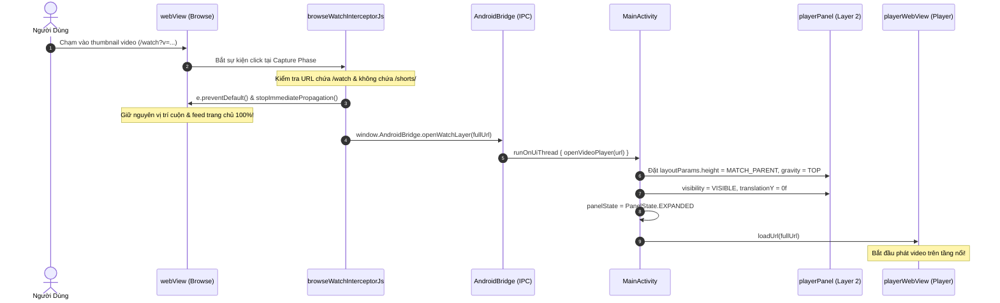
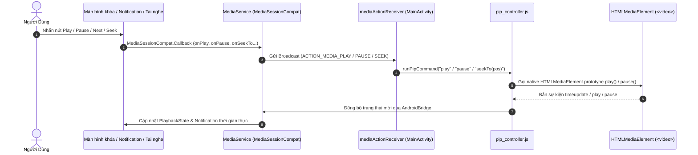
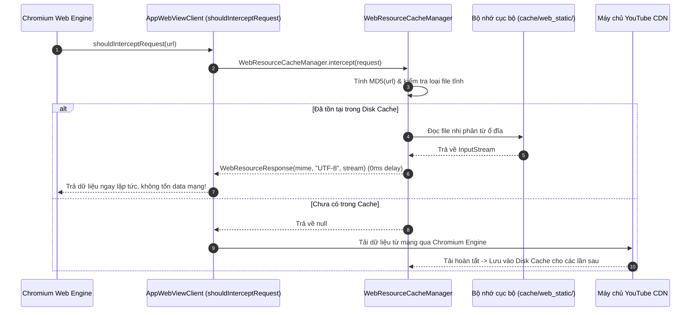

# Luồng Dữ Liệu & Quy Trình Tương Tác (Data Flow)

Tài liệu này mô tả chi tiết các chuỗi sự kiện, luồng xử lý dữ liệu và giao thức IPC (Inter-Process Communication) giữa người dùng, hệ điều hành Android, Native Kotlin và Web Engine của ứng dụng **YouTube Lite**.

---

## 1. Luồng 1: Bấm Xem Video & Kích Hoạt In-App MiniPlayer 2 Tầng

Quy trình người dùng bấm vào một video trên trang chủ và hệ thống mở lớp phát nổi đè lên mà không làm mất trang chủ bên dưới:

---

## 2. Luồng 2: Thu Nhỏ Video Thành MiniPlayer & Bung To Lại

```mermaid
sequenceDiagram
    autonumber
    actor User as Người Dùng
    participant Main as MainActivity
    participant PlayerPanel as playerPanel
    participant PlayerWeb as playerWebView
    participant MiniBar as miniPlayerBar
    participant BrowseWeb as webView (Browse)

    rect rgb(30, 30, 45)
    note right of User: Giai đoạn 1: Thu nhỏ (Collapse)
    User->>Main: Vuốt mép video xuống hoặc bấm nút mũi tên [∨]
    Main->>Main: panelState = PanelState.COLLAPSED
    Main->>MiniBar: visibility = VISIBLE
    Main->>PlayerPanel: Animate trượt xuống targetY (H - 64dp) trong 260ms
    Main->>PlayerWeb: Animate scale thu nhỏ vào khung 104dp bên trái
    Main->>PlayerPanel: withEndAction: height = 64dp, gravity = BOTTOM, translationY = 0f
    Note over BrowseWeb: Toàn bộ vùng màn hình phía trên hoàn toàn tự do nhận cảm ứng!
    end

    rect rgb(30, 45, 30)
    note right of User: Giai đoạn 2: Bung to lại (Expand)
    User->>MiniBar: Chạm vào thanh MiniPlayer hoặc vuốt lên
    Main->>Main: panelState = PanelState.EXPANDED
    Main->>PlayerPanel: height = MATCH_PARENT, gravity = TOP, translationY = targetY
    Main->>PlayerPanel: Animate trượt lên translationY = 0f trong 260ms
    Main->>PlayerWeb: Animate scale to về 1.0f
    Main->>MiniBar: visibility = GONE
    end

    rect rgb(45, 30, 30)
    note right of User: Giai đoạn 3: Đóng hẳn (Close)
    User->>MiniBar: Nhấn nút đóng [✕]
    Main->>PlayerPanel: Animate trượt hẳn xuống mép dưới màn hình (H)
    Main->>PlayerPanel: withEndAction: visibility = GONE
    Main->>PlayerWeb: loadUrl("about:blank")
    Main->>Main: stopMediaService() & updatePipParams()
    end
```

---

## 3. Luồng 3: Điều Khiển Media Từ Hệ Thống (Lockscreen, Notification, Bluetooth)

---

## 4. Luồng 4: Bộ Nhớ Đệm Tài Nguyên Tĩnh (Static Preload Cache)

