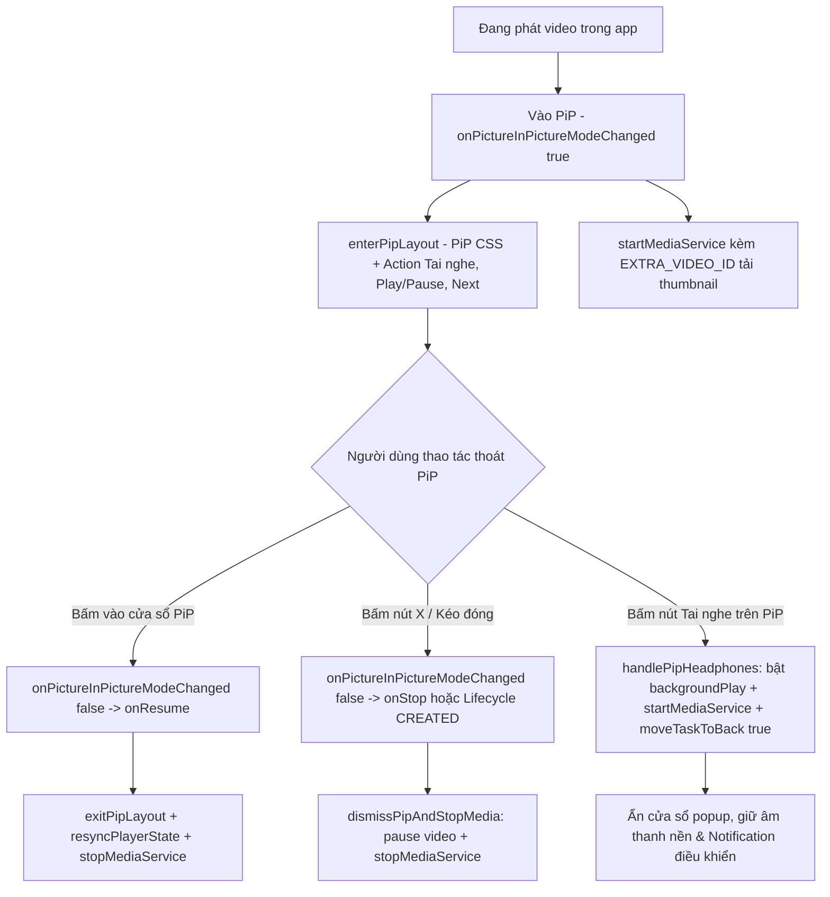

# Kế Hoạch Phân Tích, Sửa Lỗi & Kiểm Tra PiP / Player / MediaService (LiteTube)

Tài liệu này phân tích nguyên nhân gốc rễ, trình bày phương án xử lý đã áp dụng và danh sách kịch bản kiểm tra cho 6 vấn đề liên quan đến trình phát video, cửa sổ popup (PiP) và Media Player (`MediaService`).

---

## 1. Phân Tích Các Vấn Đề & Nguyên Nhân Gốc

### 1.1. Mở video phải bấm `"TAP TO UNMUTE"` mới có âm thanh
- **Hiện tượng:** Khi chọn video từ trang chủ (`webView`) sang lớp phát video (`playerWebView`), video tự phát nhưng bị tắt tiếng kèm nút phủ `"TAP TO UNMUTE"` ở góc trên trái video.
- **Nguyên nhân:** `playerWebView.loadUrl(fullUrl)` được gọi bằng code Java/Kotlin sau khi chặn URL ở `webView`, nên Chromium bên trong `playerWebView` không ghi nhận thao tác chạm trực tiếp trước đó và YouTube Mobile JS tự bật trạng thái tắt tiếng ban đầu (`muted = true`), hiển thị lớp phủ `.ytp-unmute`. `youtube_defuser.js` trước đây chỉ unmute sau khi tua quảng cáo SSAI, chưa có cơ chế tự unmute khi khởi tạo video mới.

### 1.2. Video Player còn thanh header `YouTube` / `Open App` / `3 chấm`
- **Hiện tượng:** Trên màn hình xem video (`playerWebView`), phía trên video vẫn còn thanh header của `m.youtube.com` gồm logo YouTube, nút pill `Open App`, kính lúp và menu 3 chấm.
- **Nguyên nhân:**
  1. `cosmetic_rules.css` dùng chung cho cả Browse và Player, trong đó luật cũ chỉ ẩn `button[aria-label*="Open App" i]` (không bắt được thẻ `<a>` hoặc renderer mới) và vẫn giữ lại `ytm-header-bar`.
  2. Lớp `playerPanel` của app đã có sẵn nút thu nhỏ gốc (`btnMinimizePlayer`) và vùng kéo `playerDragArea` đè ở góc trên, nên thanh header web bên trong `playerWebView` vừa thừa vừa chiếm chỗ video.

### 1.3. Mở lại từ Popup (PiP) lên trang video bị kẹt nút Play/Pause hoặc xoay vòng tròn loading liên tục
- **Hiện tượng:** Khi phóng to từ cửa sổ PiP trở lại màn hình video đầy đủ, nút Play/Pause bị kẹt trạng thái hoặc biểu tượng loading (`.ytp-spinner`) quay tròn liên tục không thao tác được; phải tua video mới hồi lại.
- **Nguyên nhân tổng hợp 4 điểm nghẽn:**
  1. **Bỏ qua trạng thái `BUFFERING (3)` trong `resyncPlayerState()`:** `pip_controller.js` chỉ gọi `p.playVideo()` khi `st !== 1 && st !== 3`. Khi YouTube rơi vào trạng thái `3` (Buffering / đang xoay vòng) vì `pause()` bị chặn hoặc resize Surface WebView, `resyncPlayerState()` bỏ qua hoàn toàn. Hơn nữa, gọi `p.playVideo()` khi thẻ `<video>` vốn đã `!paused` không tạo ra DOM event `'playing'` mới khiến máy trạng thái UI của YouTube không tắt spinner.
  2. **Tắc decoder phần cứng WebView khi đổi kích thước Surface (`PiP -> Full`):** Khi thu nhỏ rồi bung to lại WebView, luồng giải mã khung hình đôi lúc đứng yên tại `currentTime` cũ cho tới khi có thao tác seek (`"tua video"` mới hết).
  3. **Race condition giữa `exit()` và `checkViewportSize()` + `onResume()`:** Khi `onPictureInPictureModeChanged(false)` gọi `exit()`, animation thu phóng hệ thống vẫn đang chạy nên `window.innerHeight` tạm thời vẫn `<= 280px`; sự kiện `resize` lập tức kích hoạt `checkViewportSize()` bật lại CSS PiP. Sau đó `onResume()` lại gọi `exit()` lần 2 làm xóa cờ chuyển tiếp và để sót các `setTimeout` chưa hủy từ `enter()` / `stopLoop()`.
  4. **Touch selector chưa phủ hết vùng control:** Một số lớp overlay trên `m.youtube.com` nằm ở container điều khiển riêng nên thao tác chạm đôi lúc chưa kịp hủy `__braveProtectPlayUntil`.

### 1.4. `MediaService` không hiện khi ở Popup (PiP) và thiếu ảnh Thumbnail
- **Hiện tượng:** Khi thu về cửa sổ popup PiP, notification Media Player không hiển thị (chỉ hiện khi tắt màn hình / bấm Home khi tắt Auto-PiP), và ảnh bìa thumbnail video không hiện.
- **Nguyên nhân:**
  1. `startMediaService()` trước đây chỉ được gọi trong `MainActivity.onStop()`. Ở chế độ Android PiP, Activity vẫn ở trạng thái hiển thị (`STARTED + PAUSED`), không gọi `onStop()`, nên `MediaService` chưa bao giờ khởi chạy khi đang xem PiP. Ngược lại `onStart()` từng gọi `stopMediaService()` vô điều kiện.
  2. `youtube_defuser.js` và `MediaBridge` chưa trích xuất và truyền `videoId` sang `MediaService` qua `MediaService.EXTRA_VIDEO_ID`.

### 1.5. Bấm dấu `[X]` đóng Popup PiP nhưng video/media vẫn chạy nền
- **Hiện tượng:** Khi bấm `[X]` hoặc kéo đóng cửa sổ PiP, cửa sổ mất nhưng âm thanh và `MediaService` tiếp tục chạy ngầm.
- **Nguyên nhân:** Khi bấm `[X]` trên PiP, Android gọi `onPictureInPictureModeChanged(false)` rồi gọi tiếp `onStop()` (không gọi `onResume()`). `MainActivity.onStop()` thấy `isVideoPlaying && backgroundPlay` nên lập tức gọi `setBackground(true)` và `startMediaService()`, coi như người dùng bấm nút Home để nghe nền.

### 1.6. Thêm nút Tai nghe (trái Play/Pause) và nút Next (phải Play/Pause) trên cửa sổ PiP
- **Yêu cầu:**
  - Trái nút Play/Pause: **Nút Tai nghe** — bấm vào sẽ ẩn cửa sổ video popup nhưng giữ nguyên phát âm thanh và Media Player chạy nền.
  - Phải nút Play/Pause: **Nút Video tiếp theo** — chuyển sang phát video kế tiếp ngay trong PiP.

---

## 2. Sơ Đồ Luồng Vòng Đời PiP & MediaService

---

## 3. Phương Án Sửa & Chi Tiết Thay Đổi Mã Nguồn

| Hạng mục | File thay đổi | Thay đổi đã thực hiện |
| :--- | :--- | :--- |
| **Auto-Unmute & `videoId` Metadata** | [`youtube_defuser.js`](../app/src/main/assets/scriptlets/youtube_defuser.js) | Thêm `extractVideoId()`, `isAdShowingNow()`, `tryAutoUnmute()` (click nút phủ `.ytp-unmute` hiển thị, gọi `player.unMute()` / `setVolume(100)`, gán `video.muted = false` trong 8 giây đầu mỗi video mới; tôn trọng nếu người dùng chủ động nhấn `.ytp-mute-button`). Nâng cấp `extractMetadata()` kết hợp `player.getVideoData()` và gọi `AndroidBridge.onMediaStateWithId(...)` kèm `videoId`. |
| **Sửa kẹt Play/Pause, Spinner & Next trong PiP** | [`pip_controller.js`](../app/src/main/assets/scriptlets/pip_controller.js) | Quản lý tập trung toàn bộ timer bằng `scheduleRetry()` / `clearRetryTimers()`. Thêm cửa sổ `exitingUntil` (1200ms) ngăn `checkViewportSize()` tự bật lại CSS PiP khi cửa sổ đang animate thoát PiP. Sửa `resyncPlayerState()` xử lý cả trạng thái `BUFFERING (3)` / `PAUSED (2)` / `UNSTARTED (-1)` bằng cách bắn sự kiện `'canplay'`, `'play'`, `'playing'` khi `readyState >= 2`, kèm kiểm tra kẹt khung hình ở +650ms (kick `currentTime` tại chỗ chỉ khi thực sự đứng hình). Sửa selector `ytm-watch-next-secondary-results-renderer` trong `next()` và bỏ qua video trùng ID/Shorts. Giữ trạng thái `__braveUserPaused` khi `setBackground(false)`. |
| **Ẩn Header trên Player** | [`AppWebViewClient.kt`](../app/src/main/java/com/brave/youtubelite/network/AppWebViewClient.kt) [`cosmetic_rules.css`](../app/src/main/assets/filters/cosmetic_rules.css) [`activity_main.xml`](../app/src/main/res/layout/activity_main.xml) | Bổ sung `injectPlayerUiCssJs` tiêm riêng cho `playerWebView` (`!isBrowseMode`) luôn hoạt động độc lập với trạng thái AdBlock: ẩn triệt để `ytm-mobile-topbar-renderer`, `ytm-header-bar`, `#header-bar`, `.mobile-topbar-header` và đưa `#player-container-id` về `top: 0`. Tăng cường luật ẩn nút `Open App` dạng thẻ `<a>` trong `cosmetic_rules.css`. Thu gọn vùng `playerDragArea` (`marginStart="56dp"`, `marginEnd="108dp"`, `height="44dp"`) để chừa góc phải cho nút cài đặt/phụ đề trên video sau khi thanh video dâng lên sát mép trên. |
| **Tải Thumbnail & Vòng đời `MediaService`** | [`MediaService.kt`](../app/src/main/java/com/brave/youtubelite/service/MediaService.kt) | Hỗ trợ `EXTRA_VIDEO_ID`, tải ảnh thumbnail từ `https://i.ytimg.com/vi/<videoId>/<name>.jpg` theo thứ tự nét giảm dần (`maxresdefault`, `hq720`, `mqdefault`, `hqdefault`), lọc bỏ ảnh mặc định `<= 120px`, gắn vào `MediaMetadataCompat` và `setLargeIcon()`. Thêm `ensureMediaSession()` để khởi tạo lại an toàn nếu service được bật lại sau `stopPlayback()`, và bỏ qua `ACTION_UPDATE` nếu service chưa chạy foreground. |
| **3 nút PiP & Phân biệt `[X]` vs Tai nghe vs Mở app** | [`MainActivity.kt`](../app/src/main/java/com/brave/youtubelite/MainActivity.kt) [`ic_pip_headphones.xml`](../app/src/main/res/drawable/ic_pip_headphones.xml) | Tạo vector icon tai nghe `ic_pip_headphones.xml`. Cập nhật `buildPipParams()` với 3 `RemoteAction` theo thứ tự: `[Tai nghe (ACTION_PIP_HEADPHONES) | Play/Pause | Tiếp theo (ACTION_MEDIA_NEXT)]` (tự động thích ứng theo `maxNumPictureInPictureActions`). Bổ sung `handlePipHeadphones()` (bật background audio + khởi động `MediaService` + `moveTaskToBack(true)`) và `dismissPipAndStopMedia()` (dừng video + tắt `MediaService` khi đóng PiP bằng `[X]`). Mở `MediaService` ngay khi vào PiP và truyền `EXTRA_VIDEO_ID` xuyên suốt `openVideoPlayer()` / `MediaBridge.onMediaStateWithId()`. |

---

## 4. Phương Án Kiểm Tra (Verification Plan)

### 4.1. Kiểm tra tĩnh & Cú pháp (Trên máy phát triển)
- [x] Kiểm tra cú pháp JavaScript bằng `node --check` đối với `youtube_defuser.js` và `pip_controller.js`.
- [x] Kiểm tra hợp lệ cấu trúc XML đối với `ic_pip_headphones.xml` và `activity_main.xml`.
- [ ] Biên dịch Kotlin / Build Debug APK trên môi trường có **JDK 17 + Android SDK** (hoặc qua GitHub Actions workflow `.github/workflows/build-apk.yml`). *(Ghi chú: Máy cục bộ hiện chỉ có Java 8 và OpenJDK 25 không tương thích Gradle 8.4 và chưa cài Android SDK).*

### 4.2. Kiểm tra chức năng trên thiết bị Android thực tế (Sau khi cài APK)
1. **Auto-Unmute & Giao diện Player:**
   - Mở app, chạm một video bất kỳ ở Trang chủ.
   - *Kỳ vọng:* Video phát có âm thanh ngay, không hiện nhãn `"TAP TO UNMUTE"`; không còn thanh YouTube / Open App / tìm kiếm / 3 chấm phía trên video; góc trên trái vẫn có nút mũi tên thu nhỏ và góc trên phải video vẫn bấm được nút Cài đặt/Phụ đề của player.
   - Thử chủ động tắt tiếng bằng nút loa trên player: âm thanh giữ nguyên trạng thái tắt tiếng, không tự bật lại.
2. **Media Player & 3 nút trong Popup (PiP):**
   - Đang phát video -> bấm nút Home để vào cửa sổ PiP.
   - *Kỳ vọng:* Cửa sổ PiP hiển thị đúng 3 nút theo thứ tự từ trái sang phải: **Tai nghe | Tạm dừng/Phát | Tiếp theo**. Kéo thanh thông báo Android xuống thấy Notification Media Player của LiteTube kèm **ảnh thumbnail** của video đang phát.
3. **Nút Video tiếp theo trên PiP:**
   - Trong cửa sổ PiP -> bấm nút **Tiếp theo** (bên phải Play/Pause).
   - *Kỳ vọng:* PiP chuyển sang phát video tiếp theo có tiếng, tiêu đề + ảnh thumbnail trên Notification cập nhật theo video mới.
4. **Nút Tai nghe trên PiP:**
   - Trong cửa sổ PiP -> bấm nút **Tai nghe** (bên trái Play/Pause).
   - *Kỳ vọng:* Cửa sổ popup biến mất khỏi màn hình, âm thanh vẫn tiếp tục phát mượt mà và Notification Media Player vẫn hiển thị bình thường. Bấm vào Notification sẽ mở lại app.
5. **Bấm `[X]` đóng PiP:**
   - Mở PiP -> bấm dấu `[X]` (hoặc kéo xuống đáy để đóng popup).
   - *Kỳ vọng:* Cửa sổ PiP đóng lại, video dừng phát ngay lập tức và Notification Media Player biến mất hoàn toàn (không còn chạy âm thanh nền).
6. **Phóng to từ PiP lên trang video đầy đủ:**
   - Đang phát trong PiP -> chạm vào giữa cửa sổ PiP để phóng to lại app (thử cả khi đang phát và khi đang tạm dừng trong PiP).
   - *Kỳ vọng:* Trình phát lên toàn màn hình mượt mà, **không bị xoay vòng tròn loading vô tận**, nút Play/Pause phản hồi ngay lập tức khi chạm mà không cần tua video.
