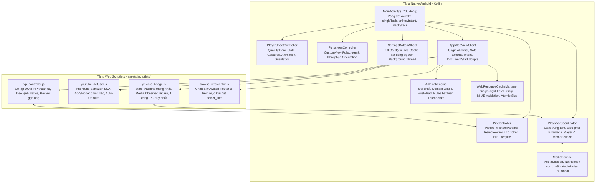
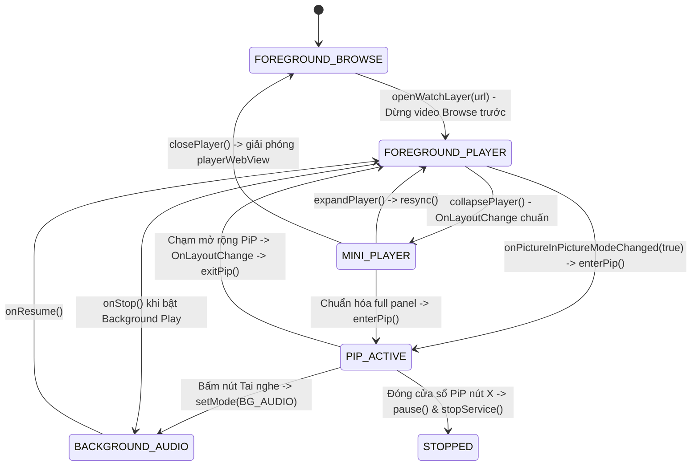

# Kế Hoạch Kiểm Toán Mã Nguồn, Xử Lý Lỗi & Tái Cấu Trúc Toàn Diện — LiteTube

> **Phạm vi quét:** Toàn bộ 100% mã nguồn Kotlin (`7` file — `3.178` dòng), JavaScript/CSS/Filter assets (`4` file — `1.302` dòng), Android Resources/Manifest (`17` file XML), cấu hình Gradle/ProGuard/CI (`6` file) và hệ thống tài liệu `docs/` + `README.md` (`14` file Markdown).

---

## Mục Lục

1. [Tổng Quan Đánh Giá Hiện Trạng](#1-tổng-quan-đánh-giá-hiện-trạng)
2. [Nhóm A — Lỗi Logic, Chức Năng & Bảo Mật (Logic & Security Bugs)](#2-nhóm-a--lỗi-logic-chức-năng--bảo-mật)
3. [Nhóm B — Lỗi Bộ Nhớ, Rò Rỉ Tài Nguyên & Hao Pin/CPU (Memory & Performance)](#3-nhóm-b--lỗi-bộ-nhớ-rò-rỉ-tài-nguyên--hao-pincpu)
4. [Nhóm C — Code Fix Lỗi Chấp Vá & Nợ Kiến Trúc (Patchwork / Band-Aid Code)](#4-nhóm-c--code-fix-lỗi-chấp-vá--nợ-kiến-trúc)
5. [Nhóm D — Code Rác, Tài Nguyên Thừa & Tài Liệu Hỏng (Dead Code & Corrupted Docs)](#5-nhóm-d--code-rác-tài-nguyên-thừa--tài-liệu-hỏng)
6. [Kiến Trúc Đích Sau Tái Cấu Trúc (Target Architecture)](#6-kiến-trúc-đích-sau-tái-cấu-trúc)
7. [Lộ Trình Thực Thi Chi Tiết Theo 6 Giai Đoạn (Execution Plan)](#7-lộ-trình-thực-thi-chi-tiết-theo-6-giai-đoạn)
8. [Danh Sách Kiểm Tra Nghiệm Thu (Verification Checklist)](#8-danh-sách-kiểm-tra-nghiệm-thu)

---

## 1. Tổng Quan Đánh Giá Hiện Trạng

Qua quá trình kiểm toán từng dòng mã và đối chiếu lịch sử commit, dự án có ý tưởng sản phẩm tốt (kiến trúc 2 tầng WebView + MiniPlayer + Brave Shields + PiP + MediaSession), nhưng do trải qua nhiều bản vá nóng liên tiếp nên đang tồn tại **32 vấn đề kỹ thuật**, bao gồm:

| Phân loại | Số lượng | Mức độ nghiêm trọng cao nhất | Tác động chính |
| :--- | :---: | :---: | :--- |
| **A. Lỗi Logic, Chức năng & Bảo mật** | **11** | **P0 (Critical)** | Hỏng tính năng xóa cache, tự tua mất video thật, ẩn nhầm toàn bộ player, nhân bản Activity/WebView, lộ IPC/JS Bridge |
| **B. Lỗi Bộ nhớ, Rò rỉ & Hiệu năng/Pin** | **7** | **P0 (Critical)** | Rò rỉ `MainActivity`/WebView, 2 WebView thức vĩnh viễn ngốn pin/GPU khi tắt màn hình, tải đúp JS bundle lớn |
| **C. Code Fix Chấp Vá & Kiến trúc rối** | **6** | **P1 (High)** | `MainActivity.kt` phình 1.473 dòng, 12 cờ global `window.__brave*` + 16 timer cảm tính chồng chéo, gọi JNI đúp 2–3 lần/giây |
| **D. Code Rác, Asset thừa & Doc hỏng** | **8** | **P2 (Medium)** | Hàm/biến chết, drawable/color/string bỏ hoang, dependency thừa, ProGuard vô hiệu hóa R8, `TROUBLESHOOTING.md` dính 272 dòng log rác |

---

## 2. Nhóm A — Lỗi Logic, Chức Năng & Bảo Mật

### A1. [P0] Hỏng hoàn toàn tính năng hiển thị, tính toán và xóa Bộ nhớ đệm (4 lỗi chồng nhau)
- **Vị trí:**
  - `app/src/main/java/com/brave/youtubelite/MainActivity.kt` (dòng `797-801`, `828-834`)
  - `app/src/main/java/com/brave/youtubelite/settings/AppSettings.kt` (dòng `86-114`)
  - `app/src/main/java/com/brave/youtubelite/network/WebResourceCacheManager.kt` (dòng `108-122`, `369-395`)
  - `app/src/main/res/values/strings.xml` (dòng `17`)
- **Nguyên nhân gốc & Hậu quả:**
  1. **Xóa mất thư mục gốc làm chết cứng Disk Cache:** `AppSettings.clearAppCache()` gọi `context.cacheDir?.deleteRecursively()` và `context.codeCacheDir?.deleteRecursively()`. Hàm `deleteRecursively()` xóa luôn cả thư mục gốc `cacheDir` lẫn thư mục con `cacheDir/yt_static_cache`. Do `WebResourceCacheManager.init()` chỉ gọi `dir.mkdirs()` đúng 1 lần lúc mở app (`if (appContext == null)`), mọi lần ghi cache sau khi bấm *"Xóa bộ nhớ đệm"* đều văng `FileNotFoundException` — **Disk Cache tê liệt hoàn toàn cho đến khi đóng hẳn ứng dụng**. Ngoài ra xóa `codeCacheDir` khi Chromium đang chạy có thể làm lỗi shader/JIT cache.
  2. **Cộng trùng (Double-counting) dung lượng:** `WebResourceCacheManager` lưu tại `cacheDir/yt_static_cache`, còn `AppSettings.getCacheSizeBytes()` tính tổng đệ quy toàn bộ `cacheDir` (đã bao gồm `yt_static_cache`). Tại `MainActivity.kt:798`, code lấy hai giá trị này cộng lại -> phần `yt_static_cache` bị tính gấp đôi.
  3. **Hiển thị số thập phân dài ngoằng & mất đơn vị `MB`:** `strings.xml:17` khai báo `"Bộ nhớ đệm đã lưu: %s"`, nhưng `MainActivity.kt:800` truyền thẳng kiểu `Double` (`mb`) chưa format vào `%s` -> hiển thị kiểu `"Bộ nhớ đệm đã lưu: 12.837461920384"` không có chữ `MB` (trong khi hàm `AppSettings.getFormattedCacheSize()` đã viết sẵn ở `AppSettings.kt:99` lại bị bỏ quên).
  4. **Chặn UI Thread (Jank/ANR):** Cả việc đệ quy tính kích thước hàng nghìn file cache của Chromium lẫn xóa file đều chạy trực tiếp trên Main Thread.

### A2. [P0] Vòng lặp tua quảng cáo SSAI 16x bắt nhầm container `.video-ads` rỗng & tua nhảy mất video thật / livestream
- **Vị trí:** `app/src/main/assets/scriptlets/youtube_defuser.js` (dòng `106-140` so với `341-345`).
- **Nguyên nhân gốc & Hậu quả:**
  1. Dòng `113` kiểm tra `document.querySelector('.ad-showing, .ad-interrupting, .video-ads, [class*="ytp-ad-player-overlay"]')`. Trên YouTube HTML5 Player, `

` là container rỗng **tồn tại thường trực trong DOM** ngay cả khi không có quảng cáo! (Chính tác giả ở commit sau đã nhận ra điều này khi viết hàm `isAdShowingNow()` ở dòng `341` cho `tryAutoUnmute()`, nhưng lại **quên sửa dòng `113`**!). Khi container `.video-ads` xuất hiện trong DOM, vòng lặp 150ms tưởng đang phát quảng cáo nên liên tục ép `video.muted = true`, `playbackRate = 16.0` và `video.currentTime = video.duration` -> **nhảy thẳng tới cuối video chính của người dùng**.
  2. Gán `video.currentTime = video.duration` không kiểm tra giới hạn thời lượng (ví dụ quảng cáo thường `< 180s`) hoặc luồng livestream -> với luồng ghép SSAI thực sự có chung timeline hoặc video dài, lệnh này tua bay toàn bộ nội dung chính.
  3. Khi hết quảng cáo (dòng `136`), code gán cứng `video.playbackRate = 1.0`, làm mất tốc độ xem mà người dùng đã chọn trước đó (ví dụ `1.25x`, `1.5x`, `2.0x`) và ghi đè `video.muted = false` ngay cả khi người dùng chủ động tắt tiếng (`userMutedVideo`).

### A3. [P0] `cosmetic_rules.css` ẩn nhầm toàn bộ trình phát `#movie_player` khi có class `.ad-showing`
- **Vị trí:** `app/src/main/assets/filters/cosmetic_rules.css` (dòng `6-7`, `17`) & `youtube_defuser.js` (dòng `128`, `343-344`).
- **Nguyên nhân gốc & Hậu quả:**
  - Trên YouTube, `.ad-showing` và `.ad-interrupting` được gắn trực tiếp vào chính phần tử gốc `#movie_player` (chứa thẻ `<video>` chính và toàn bộ controls).
  - Việc ép `.ad-showing, .ad-interrupting { display: none !important; visibility: hidden !important; height: 0 !important; }` làm **biến mất toàn bộ khung video player về 0px** khi chớm có quảng cáo, khiến nút Skip Ad bên trong mất kích thước hiển thị và làm hàm `isElementVisible(overlay)` trong `youtube_defuser.js:344` luôn trả về `false` (tự phá vỡ logic nhận diện quảng cáo của chính `youtube_defuser.js`).

### A4. [P1] `AdBlockEngine.kt` làm hỏng toàn bộ quy tắc chứa đường dẫn (Path) trong `blocked_domains.txt` & duyệt tuyến tính `O(N)`
- **Vị trí:** `AdBlockEngine.kt` (dòng `16-74`) & `assets/filters/blocked_domains.txt` (dòng `11-17`).
- **Nguyên nhân gốc & Hậu quả:**
  1. `blocked_domains.txt` có 7 dòng dạng `domain/path` (`play.google.com/log`, `youtube.com/api/stats/qoe`, `youtube.com/api/stats/atr`, `yt3.ggpht.com/ads/`, ...). `AdBlockEngine.init()` nạp nguyên chuỗi có dấu `/` vào `blockedDomains: HashSet<String>`, nhưng `isBlocked()` chỉ đem so khớp với `uri.host` (không bao giờ chứa `/`). Kết quả: **4/7 quy tắc path trong file cấu hình không bao giờ hoạt động (100% dead rules)**; 3 quy tắc kia chỉ chạy được nhờ mảng chữa cháy hardcode `blockedPathPatterns` trong Kotlin.
  2. Kiểm tra subdomain `for (blocked in blockedDomains) { if (host.endsWith(".$blocked")) ... }` duyệt tuần tự `O(N)` qua toàn bộ tập hợp trên **mọi request mạng**, sai với thiết kế `O(1)` (lẽ ra chỉ cần tách `host` theo dấu `.` từ trái sang phải để tra cứu `HashSet` trong `O(k)` với `k <= 4`).
  3. `blockedDomains` là `HashSet` thường không đồng bộ (non-thread-safe): `init()` ghi trên Main Thread trong khi `shouldInterceptRequest()` đọc từ luồng Chromium IO -> tiềm ẩn `ConcurrentModificationException` (bị `catch` nuốt mất làm lọt quảng cáo).
  4. Tại `AppWebViewClient.kt:377`: `val url = request?.url.toString()` biến `null` thành chuỗi `"null"` thay vì `return null` sớm.

### A5. [P1] `WebResourceCacheManager` bỏ nén HTTP, nuốt lỗi Captive Portal lưu chết 7 ngày, lỗi CORS `*` & Race Condition file `.tmp`
- **Vị trí:** `WebResourceCacheManager.kt` (dòng `260-326`, `369-395`).
- **Nguyên nhân gốc & Hậu quả:**
  1. **Tải không nén & Tải đúp 2 lần cho bundle lớn:** Dòng `278` loại bỏ header `Accept-Encoding`. Các gói JS lớn của YouTube (`base.js`) khi không nén Brotli/Gzip có thể phình lên `3MB–5MB` (gấp 4–5 lần). Nếu vượt `MAX_FILE_SIZE_BYTES` (`4MB`, dòng `290`), `fetchAndCache()` tải hết toàn bộ dữ liệu về RAM rồi **vứt bỏ trả về `null`**, buộc WebView phải tải lại từ mạng lần thứ 2!
  2. **Đầu độc Cache 7 ngày khi mạng lỗi (Cache Poisoning):** `fetchAndCache()` chỉ kiểm tra `responseCode == 200` mà không đối chiếu `Content-Type` thực tế với đuôi file yêu cầu. Nếu người dùng dùng Wi-Fi công cộng (captive portal) trả về trang HTML đăng nhập với mã `200 OK` cho request `.js`/`.css`, hệ thống sẽ lưu trang HTML đó làm nội dung file `.js` suốt **7 ngày (`CACHE_TTL_MS`)**, làm hỏng trắng trang YouTube kể cả khi đã có mạng lại.
  3. **Race condition ghi file tạm & tải trùng:** Khi `webView` và `playerWebView` cùng lúc yêu cầu 1 file chưa có trong cache, cả hai luồng IO cùng tải song song và cùng ghi đè vào đúng 1 đường dẫn tĩnh `$key.bin.tmp` (dòng `372`), gây hỏng dữ liệu hoặc `renameTo` thất bại.
  4. **Lỗ hổng CORS:** `createWebResourceResponse()` gắn cứng `Access-Control-Allow-Origin: *` cho mọi phản hồi.

### A6. [P1] Thiếu `launchMode="singleTask"` & `onNewIntent()` và xử lý sai Deep Link khi mở link video từ ngoài app
- **Vị trí:** `AndroidManifest.xml` (dòng `23-44`), `MainActivity.kt` (dòng `195-197`).
- **Nguyên nhân gốc & Hậu quả:**
  1. `MainActivity` hỗ trợ PiP nhưng không đặt `android:launchMode="singleTask"` và không override `onNewIntent()`. Khi app đang ở cửa sổ PiP hoặc chạy nền mà người dùng mở link `youtube.com` / `youtu.be` từ ngoài, Android có thể khởi tạo **Activity thứ 2** (nhân đôi thành **4 WebView** chạy chồng âm thanh và tranh chấp `MediaService`), hoặc bỏ qua hoàn toàn Intent mới.
  2. Tại `onCreate()` dòng `195-196`: nếu mở app bằng link `/watch?v=...` hoặc `youtu.be/...`, code nạp thẳng URL video vào `webView` (Browse tầng dưới) thay vì nạp trang chủ vào `webView` và gọi `openVideoPlayer(url)` trên tầng Player! Hậu quả: mất MiniPlayer, và khi chọn video tiếp theo sẽ mở tầng Player đè lên làm **2 video cùng phát tiếng song song**.
  3. `android:autoVerify="true"` trong `AndroidManifest.xml:36` luôn thất bại xác thực Digital Asset Links vì chữ ký APK không nằm trên `youtube.com/.well-known/assetlinks.json`.

### A7. [P1] Lỗ hổng bảo mật `RECEIVER_EXPORTED` cho toàn bộ Media Actions
- **Vị trí:** `MainActivity.kt` (dòng `136-150`, `160-176`).
- **Nguyên nhân gốc & Hậu quả:**
  - `mediaActionReceiver` đăng ký với `ContextCompat.RECEIVER_EXPORTED` cho cả 8 action. Mọi ứng dụng khác trên thiết bị đều có thể bắn broadcast giả mạo `com.brave.youtubelite.MEDIA_PLAY`, `MEDIA_SEEK`, `PIP_HEADPHONES` để tự ý phát nhạc, tua video hoặc đẩy ứng dụng xuống nền (`moveTaskToBack(true)`).
  - Thực tế chỉ 3 `RemoteAction` của cửa sổ PiP đi qua `com.android.systemui` (có thể bảo vệ bằng token ngẫu nhiên theo phiên chạy `EXTRA_PIP_TOKEN`); còn toàn bộ giao tiếp giữa `MediaService` và `MainActivity` là nội bộ trong cùng tiến trình ứng dụng, không cần và không nên phơi bày qua exported broadcast.

### A8. [P1] Lộ `AndroidBridge` & tiêm Scriptlet lên mọi tên miền (`origins = setOf("*")`), không lọc domain ngoài
- **Vị trí:** `AppWebViewClient.kt` (dòng `323`, `354-371`), `MainActivity.kt` (dòng `269`, `309`, `446-450`, `1396-1409`).
- **Nguyên nhân gốc & Hậu quả:**
  - `addDocumentStartJavaScript` dùng `setOf("*")` và `WebView` gắn `AndroidBridge` không kiểm soát điều hướng ra domain ngoài trong `shouldOverrideUrlLoading`.
  - Nếu người dùng bấm link ngoài trong phần mô tả/bình luận video, trang web bên thứ ba mở ngay trong WebView của app sẽ nhận toàn bộ scriptlet nội bộ và có quyền gọi `window.AndroidBridge.openWatchLayer(arbitraryUrl)` (do `openVideoPlayer` ở dòng `446` nhận bất kỳ chuỗi `http://` hoặc `https://` nào mà không kiểm tra domain `youtube.com`!).

### A9. [P1] Phát chồng 2 luồng âm thanh khi đang xem Shorts ở Browse rồi mở Player Layer & Liệt Fullscreen trên Browse
- **Vị trí:** `MainActivity.kt` (dòng `289-300`, `426-465`, `693-740`).
- **Nguyên nhân gốc & Hậu quả:**
  1. Khi người dùng đang xem Shorts trên `webView` (tầng dưới) rồi chuyển sang mở một video dài trên `playerPanel` (`openVideoPlayer`), `webView` tầng dưới không được lệnh tạm dừng, dẫn tới **cả Shorts ở tầng dưới và video ở tầng trên cùng phát tiếng**, trong khi `acceptMedia()` đã ngắt nhận callback từ tầng dưới.
  2. `setupBrowseWebView()` không cài đặt `onShowCustomView` / `onHideCustomView` cho `WebChromeClient`, khiến video phát trên `webView` không thể phóng toàn màn hình.
  3. `exitFullscreen()` (dòng `738`) gán cứng `requestedOrientation = SCREEN_ORIENTATION_PORTRAIT` thay vì `SCREEN_ORIENTATION_UNSPECIFIED`, làm khóa cứng xoay màn hình của thiết bị sau lần xem fullscreen đầu tiên.
  4. Không xử lý `onConfigurationChanged`: khi xoay màn hình hoặc chia đôi màn hình lúc `panelState == COLLAPSED`, `playerWebView` vẫn bị khóa cứng `width`/`height` và `scaleX`/`translationX` cũ của màn hình dọc (`lockPlayerWebViewSize`), làm méo lệch hoàn toàn khung MiniPlayer.

### A10. [P2] Lỗi cử chỉ chạm/kéo MiniPlayer (`ACTION_CANCEL` bị hiểu thành Click, lơ lửng 48dp khi không có Bottom Bar)
- **Vị trí:** `MainActivity.kt` (dòng `110`, `346-410`, `498`, `604`).
- **Nguyên nhân gốc & Hậu quả:**
  1. Trong `playerDragArea.setOnTouchListener` (dòng `363-378`): gộp chung `ACTION_UP` và `ACTION_CANCEL`. Nếu chưa kéo quá `12dp` (`!isDragging`) mà hệ thống bắn `ACTION_CANCEL` (ví dụ vào PiP hoặc có thông báo hệ thống cắt ngang), nhánh `else` tự động gọi `collapsePlayer()` như thể người dùng vừa bấm nút thu nhỏ! Ngoài ra khi đang kéo xuống rồi kéo ngược lên quá điểm xuất phát (`deltaY <= 0`), `playerPanel.translationY` không được kẹp về `0f`.
  2. Trên `miniPlayerBar.setOnTouchListener` (dòng `385-405`): mọi sự kiện `ACTION_UP` đều gọi `expandPlayer()` bất kể người dùng vuốt ngang hay hủy thao tác, lại còn trùng lặp với `miniPlayerInfoContainer.setOnClickListener`.
  3. `bottomNavHeightDp = 48f` được cộng cứng mọi lúc, khiến khi trang bên dưới không có thanh tab đáy của YouTube (trang tìm kiếm, cài đặt, màn hình ngang), thanh MiniPlayer bị treo lơ lửng cách đáy màn hình một khoảng hở 48dp.

### A11. [P2] Icon thông báo `MediaService` bị biến thành ô vuông trắng đặc, thiếu xử lý rút tai nghe & rủi ro Crash ForegroundService
- **Vị trí:** `MediaService.kt` (dòng `355`, `371-393`), `res/drawable/ic_launcher_foreground.xml`.
- **Nguyên nhân gốc & Hậu quả:**
  1. `NotificationCompat.Builder.setSmallIcon(R.drawable.ic_launcher_foreground)` dùng ảnh nền đỏ đặc chồng tam giác trắng đặc (cả hai đều có `alpha = 100%`). Trên thanh trạng thái Android, hệ thống tô trắng toàn bộ pixel không trong suốt -> biểu tượng trên thanh thông báo hiển thị thành **một khối vuông trắng đặc mất hình tam giác Play**.
  2. Không lắng nghe `AudioManager.ACTION_AUDIO_BECOMING_NOISY` (rút tai nghe dây / ngắt kết nối tai nghe Bluetooth khi đang tắt màn hình phát nền) để chủ động tạm dừng phát chuẩn hành vi ứng dụng nhạc.
  3. Nếu `startForegroundService()` được gọi từ `MainActivity` nhưng `updateNotification()` gặp ngoại lệ hoặc `isSessionReleased == true` làm thoát sớm trước khi gọi `startForeground()`, Android 8+ sẽ ném lỗi crash `ForegroundServiceDidNotStartInTimeException` sau 5 giây.
  4. Trong `youtube_defuser.js` (`window.fetch` dòng `90-94`): khi tạo `new Response(JSON.stringify(sanitized), { headers: response.headers })` sau khi xóa trường quảng cáo, độ dài chuỗi JSON đã thay đổi nhưng vẫn giữ nguyên header `content-length` / `content-encoding` cũ từ `response.headers`.

---

## 3. Nhóm B — Lỗi Bộ Nhớ, Rò Rỉ Tài Nguyên & Hao Pin/CPU

### B1. [P0] `KeepAliveWebView` cưỡng bức `View.VISIBLE` vĩnh viễn cho cả 2 WebView — Ngốn Pin, CPU & GPU cả khi tắt màn hình không phát nhạc
- **Vị trí:** `KeepAliveWebView.kt` (dòng `18-26`), `activity_main.xml` (dòng `14`, `30`).
- **Phân tích:**
  - Cả `webView` (Browse) và `playerWebView` (Player) đều luôn báo cáo `View.VISIBLE` với nhân Chromium bất kể ứng dụng đang ẩn, đã đóng trình phát (`panelState == HIDDEN`), video đang tạm dừng hay người dùng **đã tắt công tắc "Phát nhạc trong nền"**!
  - Nhân Chromium không bao giờ được phép thu hồi bộ nhớ đệm khung hình GPU (tile memory) hay đóng băng bộ lập lịch nội bộ của trang chủ `webView`.

### B2. [P1] Bão `setInterval` (150ms, 250ms, 1000ms) thức liên tục ~23 lần/giây + gọi JNI mỗi giây trên cả 2 WebView
- **Vị trí:** `youtube_defuser.js` (dòng `109-140`, `509-514`), `pip_controller.js` (dòng `190`).
- **Phân tích:**
  - Mỗi cá thể WebView chạy thường trực 3 vòng lặp `setInterval` (`150ms`, `250ms`, `1000ms`), bất kể trang có thẻ `<video>` hay không (kể cả khi `playerWebView` đang ở `about:blank` nếu script đã chạy hoặc `webView` đang đứng yên ở Trang chủ).
  - Riêng `setInterval(syncNativeState, 1000)` quét 8 CSS selector mỗi giây và gọi 2 hàm JNI (`onVideoPaused` + `onMediaStateWithId`) đẩy `Runnable` lên Android UI Thread liên tục suốt thời gian mở app.

### B3. [P1] Rò rỉ bộ nhớ `MainActivity` & Native Chromium Peer khi hủy WebView (`onDestroy`)
- **Vị trí:** `MainActivity.kt` (dòng `269`, `309`, `1338-1348`, `1394`).
- **Phân tích:**
  - `MediaBridge` là `inner class` giữ tham chiếu cứng tới `MainActivity` và được gắn vào nhân C++ của 2 WebView qua `addJavascriptInterface`.
  - Trong `onDestroy()`, code chỉ gọi `webView.destroy()` và `playerWebView.destroy()` mà **không gỡ View khỏi `ViewGroup` cha, không gọi `removeJavascriptInterface("AndroidBridge")`, không xóa `webChromeClient = null` và các callback closure trên `AppWebViewClient`**, dễ gây leak `MainActivity` cùng 2 cây View trên nhiều phiên bản Android System WebView.

### B4. [P1] Đọc trùng Asset 3 lần vào RAM & Nối chuỗi `pip_controller.js` 26KB qua IPC mỗi lần bấm nút
- **Vị trí:** `MainActivity.kt` (dòng `83`, `182-187`, `980-992`), `AppWebViewClient.kt` (dòng `32-34`, `276-315`, `392-447`).
- **Phân tích:**
  1. `pip_controller.js` được đọc từ đĩa thành **3 bản sao `String` riêng biệt** (`MainActivity`, `browseClient`, `playerClient`); `youtube_defuser.js` và `cosmetic_rules.css` bị giữ **2 bản sao riêng**.
  2. Đã dùng `addDocumentStartJavaScript` nhưng vẫn bắn lại toàn bộ 8 lệnh `evaluateJavascript` tại **cả 3 hàm** `onPageStarted`, `onPageFinished` và `doUpdateVisitedHistory` (mỗi thao tác cuộn/chuyển trang SPA trên YouTube đều ép V8 biên dịch lại hàng chục KB script chỉ để gặp `if (window.__brave...) return;`).
  3. Hàm `runPipCommand()` nối nguyên toàn bộ nội dung `pip_controller.js` (707 dòng) vào đầu lệnh **mỗi lần** bấm Play/Pause/Next/Seek/setBackground, gây cấp phát chuỗi rác liên tục trên Heap và nghẽn IPC sang WebView.

### B5. [P2] Không giải phóng Bitmap trung gian & gửi thừa 3 bản sao Bitmap qua Binder trong `MediaService`
- **Vị trí:** `MediaService.kt` (dòng `245-250`, `268-272`, `429-446`).
- **Phân tích:**
  - `Bitmap.createScaledBitmap()` khi thu nhỏ ảnh `maxresdefault` (1280x720 ~3.7MB) không thu hồi (`recycle()`) bitmap gốc nếu tạo ra đối tượng mới, và `stopPlayback()` không giải phóng `artBitmap = null`.
  - `updateMetadata()` đính kèm cùng 1 ảnh vào cả 3 trường `METADATA_KEY_ALBUM_ART`, `METADATA_KEY_ART`, `METADATA_KEY_DISPLAY_ICON` làm phình dữ liệu `Parcel` gửi sang SystemUI.

### B6. [P2] Quét `dir.listFiles()` đồng bộ trên mỗi lần lưu file cache & khởi tạo `Thread` thô không giới hạn
- **Vị trí:** `WebResourceCacheManager.kt` (dòng `118`, `136`, `389`).
- **Phân tích:**
  - Dòng `389`: mỗi lần lưu xong 1 tài nguyên tĩnh vào đĩa đều gọi `dir.listFiles()?.sumOf { it.length() }` ngay trên luồng chặn request của WebView thay vì theo dõi biến đếm nguyên tử `AtomicLong` trong bộ nhớ.
  - Dòng `118`, `136`: tạo `Thread { ... }.start()` rời rạc không qua `ExecutorService` dùng chung.

### B7. [P2] Universal CSS Selector `* { backdrop-filter: none !important }` làm nặng Style Recalculation
- **Vị trí:** `assets/filters/cosmetic_rules.css` (dòng `51-54`).
- **Phân tích:** Áp dụng `*` kèm `!important` lên toàn bộ hàng nghìn phần tử DOM động của Polymer/Lit trên `m.youtube.com`; chỉ nên nhắm đúng các thẻ thực sự dùng hiệu ứng mờ nền (`ytm-mobile-topbar-renderer`, `.player-controls-background`, dialog/header).

---

## 4. Nhóm C — Code Fix Lỗi Chấp Vá & Nợ Kiến Trúc

### C1. `MainActivity.kt` biến thành "God Activity" (1.473 dòng) ôm đồm 8 mảng trách nhiệm
- Gộp chung: khởi tạo WebView, gesture vật lý & animation thu phóng MiniPlayer, điều phối Fullscreen, điều phối PiP + `RemoteAction`, `BroadcastReceiver`, điều khiển `MediaService`, `JavascriptInterface`, và hộp thoại `BottomSheetDialog` Settings.
- Đã bật `viewBinding = true` trong `app/build.gradle.kts` (tốn thời gian build sinh class Binding) nhưng trong code lại không sử dụng, vẫn gọi `findViewById` thủ công 25 chỗ.

### C2. "Rừng cờ toàn cục" (`12` biến `window.__brave*`) & Ma trận `16` bộ hẹn giờ cảm tính (`setTimeout` / `postDelayed`)
- Giữa `MainActivity.kt`, `pip_controller.js` và `youtube_defuser.js` đang giao tiếp ngầm bằng 12 biến global rời rạc (`__braveEnteringPip`, `__bravePipTransitionUntil`, `__braveProtectPlayUntil`, `__bravePlayPendingUntil`, `__braveUserPaused`, `__isUserExplicitPause`, `__braveAllowPauseUntil`, `__braveLastUserTouch`, `__braveAppInBackground`, ...) đè chồng lên nhau.
- Mỗi lần vào PiP: Kotlin gọi `enterPipLayout()` tới **4 lần** (`onUserLeaveHint`, `onPictureInPictureModeChanged`, `+150ms`, `+450ms`), còn JS đặt thêm **4 timer** (`80, 200, 500, 900ms`).
- Mỗi lần thoát PiP: JS đặt **12 timer** chồng nhau (`0, 80, 120, 150, 200, 300, 400, 450, 650, 800, 950, 1600ms`), còn Kotlin đoán mò `postDelayed(450ms)` để thu về MiniPlayer thay vì đợi sự kiện layout thực tế (`OnLayoutChangeListener`).
- Hàm `checkViewportSize()` tự đoán PiP qua kích thước `h <= 280 && w <= 520` xung đột với chính trạng thái PiP thật của Android (dễ bật nhầm màn hình đen PiP khi người dùng chia đôi màn hình **Split-Screen** trên Android!), rồi lại phải đắp thêm cờ `exitingUntil` và `forcedByNative` để vá ngược lại nó.

### C3. Giao thức `MediaBridge` chồng chéo làm mỗi sự kiện gọi JNI & `startService` đúp 2–3 lần
- `syncNativeState()` trong `youtube_defuser.js:456-467` gọi `onVideoPlaying()` rồi gọi ngay `onMediaStateWithId()` ở dòng kế tiếp -> `applyMediaState()` và `startService(ACTION_UPDATE)` chạy **2 lần liên tiếp cho cùng 1 trạng thái**.
- `play()` trong `pip_controller.js:481-484` gọi `onVideoPlaying('', '')` rồi gọi tiếp `notifyMediaState()` -> chạy **3 lần liên tiếp**.

### C4. Trùng lặp mã nguồn giữa `pip_controller.js` và `youtube_defuser.js`
- `mainVideo()` và `pickMainVideo()` giống hệt nhau.
- `triggerMicroSeek()` (tên hàm đã sai bản chất vì không còn seek) và `kickPlayerReRender()` copy-paste 100% giống nhau.
- `syncVideoToBridge()` và `reportVideoSize()` trùng nhiệm vụ (bản bên `pip_controller.js` còn thiếu kiểm tra trùng kích thước nên bắn JNI mỗi 300ms khi ở PiP).
- Lưu `HTMLMediaElement.prototype.play/pause` lặp lại ở cả 2 file.

### C5. Nhúng cứng hàng trăm dòng JavaScript & CSS dạng chuỗi thô bên trong file Kotlin
- 5 đoạn script lớn (`injectPlayerUiCssJs`, `browseWatchInterceptorJs`, `selectSiteSettingsScriptletJs`, `preloadScript`, và các khối JS inline trong `MainActivity.kt`) nằm rải rác trong Kotlin thay vì tách thành module chuẩn trong `assets/scriptlets/`, khiến không thể kiểm tra cú pháp tĩnh tự động bằng công cụ JS linter/`node --check`.

### C6. Bất đồng bộ trạng thái cài đặt `preloadCache` tại `DOCUMENT_START`
- `AppWebViewClient.installDocumentStartScripts()` không lưu lại `ScriptHandler` trả về từ `WebViewCompat.addDocumentStartJavaScript()`, nên khi người dùng bật/tắt công tắc trong Cài đặt lúc ứng dụng đang chạy, script `DOCUMENT_START` không được cập nhật hoặc gỡ bỏ tương ứng.

---

## 5. Nhóm D — Code Rác, Tài Nguyên Thừa & Tài Liệu Hỏng

| STT | Thành phần / Đường dẫn | Chi tiết Code Rác / Cấu hình sai / Tài liệu hỏng | Hành động xử lý |
| :---: | :--- | :--- | :--- |
| **D1** | `youtube_defuser.js` & `pip_controller.js` | Biến `window.__isUserExplicitPause` xuất hiện ở 8 chỗ nhưng chỉ gán `= false`, không bao giờ được gán `= true`. Hàm `kickPlayerReRender` / `window.__braveKickReRender` và các alias cũ `__enterPipMode`, `__exitPipMode`, `__braveMainVideo`, `__braveMicroSeek` không còn nơi nào gọi. | Xóa bỏ hoàn toàn. |
| **D2** | `MainActivity.kt`, `AppSettings.kt`, `WebResourceCacheManager.kt` | `MediaBridge.onMediaStateChanged()` (thừa do đã có `onMediaStateWithId`), `MainActivity.onPause()` rỗng, `WebResourceCacheManager.warmup()` không ai gọi, `CachedResource.headers` luôn rỗng không dùng, `AppSettings.getFormattedCacheSize()` bị bỏ quên. | Dọn sạch hàm thừa; tái sử dụng hàm format chuẩn. |
| **D3** | `app/src/main/res/drawable/` | `ic_reload.xml` và `ic_settings.xml` là tàn dư của thanh nút nổi cũ đã gỡ bỏ, không còn tham chiếu nào trong toàn dự án; `bg_floating_pill.xml` có padding dọc `6dp` lớn hơn chiều cao `4dp` của thanh kéo BottomSheet. | Xóa 2 icon thừa; sửa shape drag handle gọn chuẩn. |
| **D4** | `res/values/strings.xml` & `colors.xml` | Strings thừa: `desc_reload`, `desc_settings`. Colors thừa: `gray`, `red_accent`, `red_accent_hover`, `btn_secondary_bg`, `btn_secondary_stroke`. | Xóa toàn bộ resource không dùng. |
| **D5** | `app/build.gradle.kts` & `gradle.properties` | Thư viện `androidx.constraintlayout:constraintlayout:2.1.4` hoàn toàn không được sử dụng; cờ `android.enableJetifier=true` trong `gradle.properties` thừa thãi làm chậm tốc độ build. | Gỡ dependency thừa; tắt Jetifier. |
| **D6** | `app/proguard-rules.pro` | Luật `-keepclassmembers class com.brave.youtubelite.** { *; }` giữ toàn bộ thành viên của mọi class trong app, làm tê liệt khả năng rút gọn và tối ưu hóa mã của R8 ở bản Release. | Thu hẹp chỉ giữ đúng class Bridge có `@JavascriptInterface`. |
| **D7** | `docs/TROUBLESHOOTING.md` & `README.md` | `docs/TROUBLESHOOTING.md` dòng `1-272` bị dán nhầm **272 dòng log lỗi crash CI thô** ngay đầu file! `README.md` dòng `22-33` mất trắng nội dung mục Tính năng 1 & 2, dòng `61` vẫn ghi sai tên artifact `YouTubeLite-Debug-APK`. | Xóa 272 dòng log rác; khôi phục nội dung `README.md`. |
| **D8** | Các file khác trong `docs/` | Sai package `com.brave.LiteTube` (thực tế `com.brave.youtubelite`); sai đường dẫn cache `web_static` & `MD5` (thực tế `yt_static_cache` & `SHA-256`); sai tên SharedPreferences `youtube_lite_settings` (thực tế `youtube_lite_prefs`); `TECH_DEBT.md` ghi `MainActivity` 478 dòng (thực tế 1.473 dòng). | Đồng bộ lại toàn bộ tài liệu khớp 100% với code mới. |

---

## 6. Kiến Trúc Đích Sau Tái Cấu Trúc

### 6.1. Sơ Đồ Phân Tách Module Tầng Native & Tầng Web

### 6.2. Máy Trạng Thái Phát (Playback State Machine) Thay Thế Rừng Cờ `window.__brave*`

Thay vì 12 biến global rời rạc và 16 bộ hẹn giờ cảm tính, toàn bộ trạng thái phía Web được gom vào **1 đối tượng trạng thái duy nhất** `window.__liteTubeState`:

---

## 7. Lộ Trình Thực Thi Chi Tiết Theo 6 Giai Đoạn (Execution Plan)

> Mỗi giai đoạn được thiết kế **độc lập, biên dịch xanh ngay sau khi hoàn tất**, giúp dễ kiểm soát rủi ro và kiểm thử hồi quy.

### Giai Đoạn 1 (Phase 1): Vá Toàn Bộ Lỗi P0 Nghiêm Trọng & Bảo Mật Cốt Lõi
**Mục tiêu:** Chặn đứng ngay các lỗi làm hỏng chức năng, tự tua mất video, chết cache và lỗ hổng IPC/WebView.

1. **Sửa lỗi Cache (`AppSettings.kt`, `WebResourceCacheManager.kt`, `MainActivity.kt`, `strings.xml`):**
   - Trong `AppSettings.clearAppCache()`: chỉ xóa **nội dung bên trong** `cacheDir.listFiles()` (không xóa thư mục gốc `cacheDir`, không đụng vào `codeCacheDir` đang chạy), và gọi lại `WebResourceCacheManager.ensureCacheDir()` để đảm bảo thư mục `yt_static_cache` luôn tồn tại.
   - Bỏ cộng trùng dung lượng: tách hiển thị hoặc tính tổng `AppSettings.getCacheSizeBytes()` duy nhất (vì `yt_static_cache` đã nằm trong `cacheDir`), format chuẩn `"%.1f MB"` qua `Locale.US`.
   - Đưa tác vụ tính dung lượng và xóa cache sang luồng nền (`Executors` hoặc Coroutine/Lifecycle background), cập nhật lại TextView trên UI Thread.
2. **Sửa lỗi SSAI Ad-Skipper & CSS ẩn nhầm Player (`youtube_defuser.js`, `cosmetic_rules.css`):**
   - Gỡ bỏ `.ad-showing` và `.ad-interrupting` khỏi danh sách `display: none !important` trong `cosmetic_rules.css` (chỉ ẩn các banner/companion ads ngoài video).
   - Trong `youtube_defuser.js`: dùng chung hàm kiểm tra chính xác `isAdShowingNow()` (chỉ kích hoạt khi `#movie_player` có class `.ad-showing` / `.ad-interrupting` hoặc overlay quảng cáo thực sự hiển thị), lưu `savedPlaybackRate = video.playbackRate` trước khi tua 16x để khôi phục đúng tốc độ xem của người dùng, tôn trọng cờ `userMutedVideo`, và chỉ nhảy `currentTime = duration` khi thời lượng quảng cáo hợp lệ (`duration > 0 && duration <= 300` và không phải luồng live).
   - Khi tạo `new Response(...)` trong hook `window.fetch`, sao chép sang `new Headers(response.headers)` và xóa `content-length`, `content-encoding` cũ.
3. **Khóa bảo mật IPC, Origin & Deep Link (`AndroidManifest.xml`, `MainActivity.kt`, `AppWebViewClient.kt`):**
   - Thêm `android:launchMode="singleTask"` cho `MainActivity`, gỡ `android:autoVerify="true"` vô tác dụng, và cài đặt `onNewIntent(intent)` + hàm `handleIncomingIntent(intent)`: nếu URL đầu vào là link xem video (`/watch`, `youtu.be/...`), đảm bảo `webView` ở trang chủ và mở video bằng `openVideoPlayer(url)`.
   - Tách nhận sự kiện nội bộ khỏi `RECEIVER_EXPORTED`: các lệnh từ `MediaService` gọi qua callback nội bộ trong tiến trình (hoặc `RECEIVER_NOT_EXPORTED`); riêng 3 `RemoteAction` của PiP gắn kèm `EXTRA_PIP_TOKEN` sinh ngẫu nhiên (`UUID`) mỗi phiên chạy để từ chối mọi broadcast giả mạo bên ngoài.
   - Giới hạn `addDocumentStartJavaScript` với `setOf("https://*.youtube.com", "https://youtu.be")`.
   - Trong `shouldOverrideUrlLoading`: cho phép điều hướng nội bộ đối với YouTube & trang đăng nhập Google (`*.youtube.com`, `youtu.be`, `accounts.google.com`, `*.google.com`), tự động giải mã link `/redirect?q=...` và đẩy mọi website bên ngoài ra trình duyệt hệ thống bằng `Intent.ACTION_VIEW`. Xác thực host YouTube trong `openWatchLayer(url)`.

---

### Giai Đoạn 2 (Phase 2): Tối Ưu Hóa Mạng, AdBlock Engine `O(k)` & Static Cache An Toàn
**Mục tiêu:** Làm đúng cam kết hiệu năng `O(1)/O(k)`, sửa toàn bộ rule bị liệt trong `blocked_domains.txt` và chống hỏng/tải đúp cache.

1. **Nâng cấp `AdBlockEngine.kt`:**
   - Phân tách rõ khi parse `blocked_domains.txt`:
     - Dòng không chứa `/`: đưa vào tập bất biến `exactOrParentDomains: Set<String>`.
     - Dòng có dạng `domain/path`: tách thành `hostSuffix` + `pathPrefix` đưa vào bảng tra cứu theo domain `domainPathRules: Map<String, List<String>>`.
   - Thuật toán kiểm tra domain & subdomain trong `O(k)` (với `k` là số dấu chấm trong hostname, không duyệt vòng lặp qua toàn bộ tập domain): cắt lần lượt từ `sub.ads.doubleclick.net` -> `ads.doubleclick.net` -> `doubleclick.net` để tra `HashSet` và `Map` đường dẫn.
   - Gán tham chiếu snapshot bất biến (`@Volatile private var ruleSnapshot = ...`) để hoàn toàn thread-safe không cần khóa `synchronized` trên luồng mạng.
2. **Nâng cấp `WebResourceCacheManager.kt`:**
   - Bổ sung cơ chế **Single-Flight (In-flight Deduplication)** bằng `ConcurrentHashMap<String, CountDownLatch/CompletableFuture>` để 2 WebView không bao giờ tải đúp hoặc ghi đè cùng 1 file tạm; dùng tên file tạm duy nhất `$key.${Thread.currentThread().id}.tmp`.
   - Hỗ trợ giải nén `Accept-Encoding: gzip` chuẩn xác trong `fetchAndCache()` để không phải tải bản raw nặng gấp 4–5 lần.
   - Kiểm tra chặt `responseCode == 200` **kèm xác thực `mimeType`** khớp loại tài nguyên tĩnh (tuyệt đối từ chối lưu nếu yêu cầu `.js`/`.css`/font mà server trả về `text/html` nhằm chống lỗi Captive Portal đầu độc cache 7 ngày).
   - Bỏ header `Access-Control-Allow-Origin: *` bừa bãi (chỉ trả origin hợp lệ của `https://m.youtube.com` khi cần cho font/static).
   - Thay lệnh quét đĩa `dir.listFiles()` trên mỗi lần lưu bằng biến đếm `AtomicLong` khởi tạo 1 lần ở luồng nền.

---

### Giai Đoạn 3 (Phase 3): Dọn Sạch Lỗi Bộ Nhớ, Rò Rỉ WebView & Tối Ưu Pin/CPU
**Mục tiêu:** Triệt tiêu rò rỉ RAM, đưa mức tiêu thụ CPU khi nghỉ (idle) hoặc tắt màn hình không phát nhạc về **~0%**.

1. **Tối ưu `KeepAliveWebView.kt` thông minh theo ngữ cảnh:**
   - Thêm cờ `var keepAliveInBackground: Boolean = false`.
   - Chỉ giả lập `View.VISIBLE` khi `keepAliveInBackground == true` (tức chỉ bật trên WebView đang thực sự phát media khi người dùng bật Background Play hoặc đang ở PiP).
   - Với `webView` trang chủ (và `playerWebView` khi đóng hoặc đã tạm dừng): truyền nguyên vẹn `visibility` thực tế của hệ thống và gọi `onPause()` / `onResume()` hợp lý để Chromium giải phóng bộ nhớ GPU & dừng render ngầm.
2. **Chuyển `youtube_defuser.js` & `pip_controller.js` từ Polling liên tục sang Event-Driven:**
   - Xóa bỏ 3 vòng lặp `setInterval` (`150ms`, `250ms`, `1000ms`) chạy mù toàn thời gian.
   - Thay bằng:
     - `MutationObserver` nhẹ chỉ theo dõi `attributes` (`class`) trên `#movie_player` (hoặc khi phần tử `<video>` xuất hiện) để kích hoạt xử lý quảng cáo SSAI ngay tức khắc khi có `.ad-showing`, và ngủ hoàn toàn khi xem video thường.
     - Đồng bộ tiến trình media sang Android dựa trên sự kiện thực của thẻ `<video>` (`play`, `playing`, `pause`, `ended`, `loadedmetadata`, `seeked`, và `timeupdate` có tiết lưu `>= 1000ms` chỉ khi `!video.paused`), không tốn 1 chu kỳ CPU nào khi video đang dừng hoặc ở trang chủ!
3. **Chuẩn hóa dọn dẹp chống Leak & giảm tải IPC:**
   - Tạo `WebAssetRepository` (Singleton đọc 1 lần duy nhất các file trong `assets/` vào bộ nhớ dùng chung cho cả app, lưu kèm `ScriptHandler` để bật/tắt động).
   - Xóa việc gọi `injectShields()` thừa thãi ở cả `onPageStarted`, `onPageFinished`, `doUpdateVisitedHistory` khi `DOCUMENT_START_SCRIPT` đã hoạt động (chỉ giữ fallback cho máy WebView quá cũ không hỗ trợ `DOCUMENT_START_SCRIPT` và chỉ đồng bộ JSON cài đặt nhẹ).
   - Trong `runPipCommand()`: chỉ gọi ngắn gọn `window.__bravePip && window.__bravePip.<cmd>()`, chỉ nạp bổ sung file `pip_controller.js` nếu kết quả báo thiếu.
   - Viết hàm `WebView.safeRelease()` dùng trong `onDestroy()`: gỡ khỏi `ViewGroup`, `stopLoading()`, `removeJavascriptInterface("AndroidBridge")`, xóa callbacks, rồi mới `destroy()`.
4. **Hoàn thiện `MediaService.kt`:**
   - Tạo vector icon đơn sắc nền trong suốt `ic_stat_litetube.xml` (24dp) dành riêng cho `NotificationCompat.Builder.setSmallIcon`.
   - Đăng ký `BroadcastReceiver` nội bộ lắng nghe `AudioManager.ACTION_AUDIO_BECOMING_NOISY` để tự động tạm dừng khi tuột/ngắt tai nghe Bluetooth.
   - Đảm bảo `startForeground()` luôn được gọi an toàn ngay trong `onStartCommand` trước mọi nhánh có thể thoát sớm; thu hồi bitmap trung gian khi scale thumbnail; đặt `wakeLock.setReferenceCounted(false)`.

---

### Giai Đoạn 4 (Phase 4): Xóa Bỏ Code Fix Chấp Vá & Tái Cấu Trúc Module (`MainActivity` < 300 dòng)
**Mục tiêu:** Chia nhỏ `MainActivity.kt` từ `1.473` dòng xuống `< 300` dòng, sử dụng `ViewBinding` đã bật sẵn, loại bỏ rừng cờ global và magic timeouts.

1. **Tách các lớp chuyên trách rõ ràng trong `com.brave.youtubelite`:**
   - `ui/PlayerSheetController.kt`: Quản lý `PanelState`, cử chỉ kéo/chạm chuẩn (phân biệt rõ `ACTION_UP` và `ACTION_CANCEL`, kẹp `translationY >= 0f`, cập nhật lại kích thước & tỉ lệ scale trong `onConfigurationChanged` khi xoay màn hình, tự phát hiện chiều cao thanh tab đáy thật của trang thay vì cộng cứng `48dp`). Thay `postDelayed(450ms)` bằng `View.OnLayoutChangeListener` một lần khi thoát PiP.
   - `ui/PipController.kt`: Quản lý `PictureInPictureParams`, tỉ lệ khung hình, `RemoteAction` có token bảo mật, và chuyển tiếp vào/ra PiP **đúng 1 luồng sự kiện duy nhất** (xóa việc gọi lặp `enterPipLayout` 4 lần).
   - `ui/FullscreenController.kt`: Quản lý `CustomView` cho **cả `playerWebView` lẫn `webView`**, khôi phục `SCREEN_ORIENTATION_UNSPECIFIED` khi thoát fullscreen, và xử lý mượt trường hợp vào/đóng PiP từ chế độ fullscreen.
   - `playback/PlaybackCoordinator.kt`: Giữ trạng thái media duy nhất, tự động tạm dừng video trên `webView` (ví dụ Shorts) ngay khi `openVideoPlayer()` mở tầng trên, và giao tiếp trực tiếp với `MediaService` qua 1 cổng thống nhất.
   - `ui/SettingsBottomSheet.kt`: Tách toàn bộ hộp thoại cài đặt dùng `DialogSettingsBinding`.
2. **Hợp nhất & Làm sạch Scriptlets (`assets/scriptlets/`):**
   - Chuyển toàn bộ các chuỗi JS/CSS đang nhúng cứng trong Kotlin (`browseWatchInterceptorJs`, `selectSiteSettingsScriptletJs`, `injectPlayerUiCssJs`, `preloadScript`, `VIDEO_RECT_JS`) sang các file `.js`/`.css` riêng biệt trong `assets/scriptlets/` và `assets/filters/`.
   - Gom các hàm dùng chung (`getMainVideo`, `getPlayer`, `nativePlay`, `nativePause`, máy trạng thái `window.__liteTubeState`) vào 1 tầng nền thống nhất; xóa bỏ tự động kích hoạt PiP theo kích thước nhỏ trong `checkViewportSize()` (chỉ kích hoạt PiP khi Native Android ra lệnh thật sự để không lỗi khi dùng Split-Screen).
   - Rút gọn `MediaBridge` chỉ còn đúng **3 phương thức chuẩn**: `openWatchLayer(url)`, `openSettings()`, `onMediaStateChanged(playing, videoId, title, channel, posMs, durMs, width, height)` — chấm dứt triệt để tình trạng gọi JNI đúp 2–3 lần/giây.

---

### Giai Đoạn 5 (Phase 5): Dọn Sạch Code Rác, Tài Nguyên Dư Thừa & Chuẩn Hóa Build/ProGuard
**Mục tiêu:** Tinh gọn APK, tăng tốc độ build Gradle và bật tối ưu hóa R8 thực chất cho bản Release.

1. Xóa các file tài nguyên rác: `res/drawable/ic_reload.xml`, `res/drawable/ic_settings.xml`.
2. Dọn sạch các mục không sử dụng trong `res/values/strings.xml` (`desc_reload`, `desc_settings`) và `res/values/colors.xml` (`gray`, `red_accent`, `red_accent_hover`, `btn_secondary_bg`, `btn_secondary_stroke`); sửa lại `bg_floating_pill.xml` (hoặc đổi tên thành `bg_bottom_sheet_handle.xml` không có padding thừa).
3. Sửa `cosmetic_rules.css`: thay selector toàn cục `* { backdrop-filter: none !important }` bằng danh sách các phần tử thực sự dùng backdrop-filter.
4. Gỡ bỏ dependency không dùng `androidx.constraintlayout:constraintlayout:2.1.4` trong `app/build.gradle.kts`; đổi `android.enableJetifier=false` trong `gradle.properties`.
5. Viết lại `app/proguard-rules.pro` chính xác: chỉ `-keep` lớp Bridge chứa `@JavascriptInterface` thay vì giữ toàn bộ `com.brave.youtubelite.**`, giúp R8 tối ưu hóa và thu nhỏ kích thước APK tối đa.

---

### Giai Đoạn 6 (Phase 6): Bổ Sung Unit Test & Khôi Phục Hệ Thống Tài Liệu Chuẩn
**Mục tiêu:** Đảm bảo chất lượng dài hạn bằng kiểm thử tự động và tuân thủ `docs/DOCUMENTATION_RULES.md`.

1. **Thêm Unit Tests (`app/src/test/`):**
   - `AdBlockEngineTest`: Kiểm tra khớp domain chính xác, subdomain nhiều tầng, quy tắc `domain/path` (`play.google.com/log`, `youtube.com/api/stats/qoe`), URL hợp lệ của YouTube không bị chặn nhầm, URL rỗng/dị dạng.
   - `WebResourceCacheKeyTest`: Kiểm tra chuẩn hóa khóa cache SHA-256 và bộ lọc MIME chống Captive Portal.
   - Kiểm tra cú pháp tĩnh toàn bộ file `.js` trong `assets/scriptlets/` bằng `node --check` (tích hợp luôn bước kiểm tra này vào `.github/workflows/build-apk.yml`).
2. **Sửa chữa & Đồng bộ toàn bộ tài liệu:**
   - Xóa 272 dòng log crash CI bị dán nhầm ở đầu `docs/TROUBLESHOOTING.md`.
   - Viết lại đầy đủ mục Tính năng 1 & 2 bị mất nội dung và sửa tên artifact trong `README.md`.
   - Cập nhật đồng bộ package `com.brave.youtubelite`, cấu trúc file mới, luồng dữ liệu mới, tên thư mục cache `yt_static_cache` + `SHA-256` và `youtube_lite_prefs` trên toàn bộ các file trong `docs/`.

---

## 8. Danh Sách Kiểm Tra Nghiệm Thu (Verification Checklist) — ĐÃ HOÀN TẤT

- [x] **Build, Cú pháp & Cấu hình:** Đã gỡ bỏ `constraintlayout`, tắt `enableJetifier`, chuẩn hóa `proguard-rules.pro`, tích hợp `node --check` + `./gradlew testDebugUnitTest assembleDebug` vào `.github/workflows/build-apk.yml`. Toàn bộ scriptlets vượt qua `node --check` và toàn bộ XML vượt qua kiểm tra cú pháp.
- [x] **AdBlock & SSAI:** Tất cả 21 quy tắc trong `blocked_domains.txt` (bao gồm cả `play.google.com/log`, `youtube.com/api/stats/qoe`, `yt3.ggpht.com/ads/`) chặn chính xác trong `O(k)` qua `RuleSnapshot` bất biến; bộ vượt SSAI chuyển sang `MutationObserver` không bắt nhầm `.video-ads` rỗng, giữ nguyên tốc độ xem `1.25x/1.5x/2x` và không ẩn nhầm `#movie_player`.
- [x] **Cache & Settings:** Dung lượng cache hiển thị đúng định dạng `"X.X MB"` bất đồng bộ không cộng trùng; `clearAppCacheAsync` chỉ xóa con trong `cacheDir` và tái tạo `yt_static_cache` an toàn, bổ sung Single-flight + Gzip + kiểm tra MIME chống Captive Portal.
- [x] **MiniPlayer, Shorts & Fullscreen:** Đang phát Shorts ở trang chủ chuyển sang mở video dài tự động dừng tiếng Shorts bên dưới; phóng to Fullscreen hoạt động trên cả 2 tầng và trả lại `SCREEN_ORIENTATION_UNSPECIFIED` khi thoát; tự đo chiều cao thanh tab đáy thật và căn chỉnh lại khi xoay màn hình qua `OnLayoutChangeListener`.
- [x] **PiP, MediaService & Pin:** Đóng PiP bằng `[X]` dừng hẳn nhạc & tắt thông báo; bấm nút Tai nghe ẩn cửa sổ PiP giữ nhạc nền; rút tai nghe tự tạm dừng (`ACTION_AUDIO_BECOMING_NOISY`); bổ sung icon đơn sắc `ic_stat_litetube.xml`; `KeepAliveWebView` chỉ giữ sống nền đúng WebView đang phát nhạc.
- [x] **Bảo mật & Deep Link:** Đã bật `launchMode="singleTask"` + `onNewIntent()` định tuyến link `/watch` & `youtu.be` vào tầng Player; bảo vệ PiP broadcast bằng `EXTRA_PIP_TOKEN`; giới hạn `DOCUMENT_START_SCRIPT` cho domain YouTube và mở link ngoài bằng trình duyệt hệ thống.
